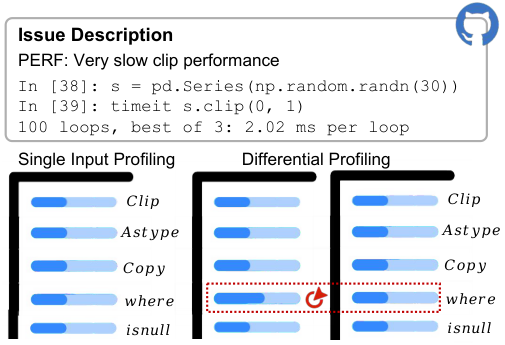
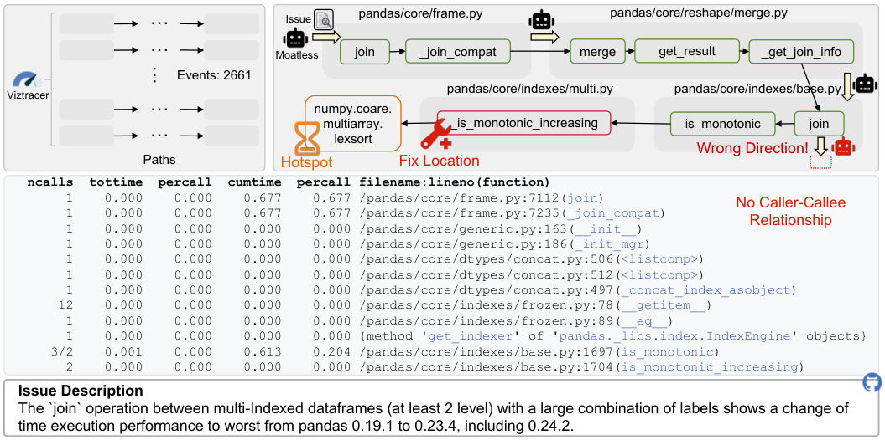
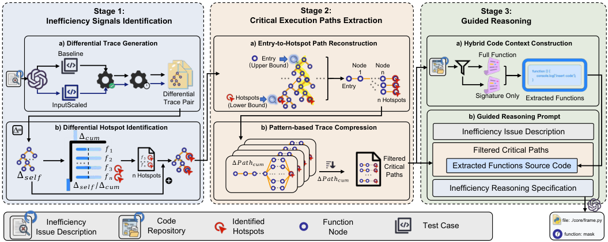
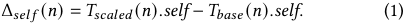
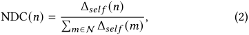

<!-- Chuyển tự động từ 2608.03558v1.pdf (pymupdf4llm); ảnh trong 2608.03558v1_images/ -->

# **EffiHolmes: Differential Profiling-Guided Repository Level Time Inefficiency Fix Localization** 

Zishuo Ding∗ Hong Kong University of Science and Technology (Guangzhou) Guangzhou, China zishuoding@hkust-gz.edu.cn 

Yun Peng Chinese University of Hong Kong Hong Kong, Hong Kong ypeng@cse.cuhk.edu.hk 

Haowen Yang Hong Kong University of Science and Technology (Guangzhou) Guangzhou, China hyang464@connect.hkust-gz.edu.cn 

<!-- Start of picture text -->
Issue Description PERF: Very slow clip performance In [38]: s = pd.Series(np.random.randn(30)) In [39]: timeit s.clip(0, 1) 100 loops, best of 3: 2.02 ms per loop Single Input Profiling Differential Profiling 퐶푙�� 퐶푙�� 퐴푠푡��� 퐴푠푡��� 퐶표�� 퐶표�� �ℎ��� �ℎ��� �푠푛�푙푙 �푠푛�푙푙 <!-- End of picture text -->

## **Abstract** 

Large software systems often suffer from time inefficiencies, leading to excessive execution time despite functional correctness. Localizing the fix locations of such inefficiency issues is notoriously difficult. Applying existing fault localization paradigms to this task presents significant challenges. Unlike functional bugs, time inefficiencies do not cause crashes or test failures. They therefore provide neither binary oracles nor stack-trace localization clues, making traditional fault localization and recent LLM-based methods not applicable. While runtime profiling provides alternative clues, it faces some challenges in repository-level settings. Single-run profiling is non-discriminative, failing to distinguish inefficiency hotspots (i.e., time-consuming functions) from execution noise. Furthermore, existing profilers struggle to extract the execution paths relevant to inefficiency from the vast background execution. Crucially, even with the extracted execution paths, a semantic gap still persists between the observed inefficiency and where to fix. 

**Figure 1: Single-Run Profiling vs Differential Profiling.** 

In this paper, we propose EffiHolmes, an LLM-based framework for localizing fix locations of repository-level time inefficiency issues. First, it employs differential profiling (default vs. scaled workloads) to pinpoint inefficiency hotspots. Second, to extract the execution paths relevant to inefficiency, it performs execution path extraction, constructing compact execution paths that connect hotspots to the reported inefficient function. Third, to bridge the gap between the hotspots and fix locations, it employs guided LLM reasoning with domain heuristics to locate the inefficiency logic. To facilitate the evaluation, we introduce RepoEffi-Bench, the first benchmark for repository-level inefficiency localization, consisting of 140 high-quality time inefficiency issues collected from popular Python repositories. The results show that EffiHolmes consistently outperforms state-of-the-art retrieval-based, agent-based, and profiling-based baselines, with gains of 4.29 pp on GPT-5.1 filelevel Acc@3 and 15.00 pp on qwen3-4b function-level Acc@5 over the best baseline. It also remains robust across model capacities. 

## **Keywords** 

repository-level performance optimization, time inefficiency, differential profiling, fix localization 

### **ACM Reference Format:** 

Haowen Yang, Yun Peng, and Zishuo Ding. 2026. EffiHolmes: Differential Profiling-Guided Repository Level Time Inefficiency Fix Localization. In _Proceedings of the 41st IEEE/ACM International Conference on Automated Software Engineering (ASE ’26), October 12–16, 2026, Munich, Germany._ ACM, New York, NY, USA, 13 pages. https://doi.org/10.1145/3832783.3834353 

## **1 Introduction** 

Large software systems often suffer from time inefficiency issues [70], which cause excessive execution time despite the program remaining functionally correct [71]. Such issues can lead to severe consequences, such as budget overrun [67], project delay [64, 70], system failures [6], and even financial losses [3, 14, 62]. For instance, a latency issue [5] in the popular trading bot _Freqtrade_ [21] resulted in additional processing time when the bot attempted to automatically sell assets to protect users during market crashes. Due to this delay, the system failed to respond immediately to price drops, causing significant financial losses. 

## **CCS Concepts** 

• **Software and its engineering** → **Software testing and debugging** . 

Accurate localization of fixes (i.e., identifying where code changes should be applied to reduce execution time) is a fundamental task to addressing these time inefficiency issues [43]. However, this task is often difficult in practice, as developers must manually construct input workloads to trigger the inefficiency, trace long and complex call chains across multiple modules, and reason about where the unjustified overhead is introduced [12]. For example, in _Xarray_ [7] Issue #9692 [2], developers faced a 30x slowdown in the 

∗Corresponding author. 

This work is licensed under a Creative Commons Attribution 4.0 International License. _ASE ’26, Munich, Germany_ 

> © 2026 Copyright held by the owner/author(s). ACM ISBN 979-8-4007-2882-2/2026/10 

> https://doi.org/10.1145/3832783.3834353 

ASE ’26, October 12–16, 2026, Munich, Germany 

Haowen Yang, Yun Peng, and Zishuo Ding 

DataArray.quantile function. It took four experts twelve days to determine where to fix, as it required tracing a deep call chain from the API to low-level thread management and reasoning across _Xarray_ ’s wrapper layers and backend. 

Despite the severe impact of time inefficiencies and the significant manual effort required for diagnosis, current approaches remain inadequate for addressing these issues. The task of pinpointing specific code regions responsible for inefficiency issues falls under the domain of fault localization (FL) [25]. Yet, applying existing FL paradigms to this task presents significant challenges. Traditional FL techniques are largely inapplicable to this task due to their reliance on explicit correctness signals. Whether employing _Spectrum-based (SBFL)_ [8, 9, 35, 54, 55, 59, 68], _Mutation-based (MBFL)_ [44, 48], or _Machine Learning-based (MLFL)_ [39, 40, 42] strategies, **these methods share a fundamental dependency on a binary oracle to distinguish failing executions from passing ones.** This assumption fails for inefficiency issues, which manifest as silent performance degradation rather than explicit failures [29, 34]. More recently, researchers have turned to LLM-based FL approaches that exploit the semantics of issue reports rather than correctness signals. Whether employing hierarchical reasoning [13, 32, 47, 60] or agent-based navigation [11, 16, 57, 63, 66], these methods share a critical limitation: **they rely heavily on explicit localization clues within the issue description** , such as stack traces or error messages. These clues are critical for guiding models to narrow the search space in complex repositories. However, time inefficiency issues differ from functional ones as they do not produce explicit failure artifacts, such as stack traces, that can serve as clues for localization. As a result, the assumption underlying LLM-based FL does not hold in repository-level inefficiency issues. 

In the absence of these clues, we use runtime profiling as an alternative source. However, this introduces new challenges. **First, static single-run profiling fails to distinguish inefficiency signals from execution noise.** A single run provides only a static snapshot where performance hotspots are often submerged in noise. As illustrated in Fig.1 using _Pandas_ Issue #15400, the faulty function executes in merely 0.002 seconds. At this low magnitude, the inefficiency is numerically indistinguishable from noise such as astype or copy. The hotspot, where, is drowned out because standard inputs are too small to allow the inefficiency to dominate. It only emerges when the input is scaled, as shown in Fig.1: the execution-time hotspot explodes while the noise remains stable. **Second, existing profilers struggle to extract the execution paths relevant to inefficiency from the vast background execution.** Aggregated profilers (e.g., cProfile [50]) provide insufficient information. They highlight which functions consume time but flatten the execution history. By discarding calling relationships, they show the symptom but hide the path between upstream control logic and downstream hotspots. In contrast, raw trace profilers (e.g., VizTracer [22]) contain excessive noise. While they preserve the full execution history, they generate millions of low-level events. This results in an extremely low signal-to-noise ratio and buries the execution paths relevant to the inefficiency. **Third, profilerreported hotspots do not reliably indicate fix locations.** Prior work [71] shows that profiler-reported hotspots primarily indicate where execution time accumulates, rather than where the issues 

originate. Execution hotspots can be amplified by repeated invocations or expensive execution paths, while the control logic that triggers such behavior may reside elsewhere in the code [58]. 

To solve these challenges, we propose EffiHolmes, an LLMbased framework that localizes where to fix time inefficiencies. Specifically, it comprises three main components. **To distinguish the inefficiency signal from execution noise** , we construct a differential test pair (default vs. scaled execution) and generate timeannotated execution traces, which allows inefficiency hotspots to be exposed through comparison. **To extract the execution paths relevant to inefficiency** , we distilled the execution paths connecting these hotspots to the reported inefficient function from the raw execution traces. Then we compress the resulting paths by grouping those with identical call-chain structures. Within each group, the critical execution path with the highest cumulative differential time is retained. **To bridge the semantic gap between profiler-reported hotspots and actual fix locations** , we employ domain-guided reasoning. Even with extracted critical execution paths, LLMs often pinpoint where time accumulates rather than where the issue originates. Therefore, this stage synthesizes structured runtime evidence with domain reasoning heuristics, explicitly guiding the LLM to trace upstream to the defective control logic. 

Additionally, to evaluate our approach, we introduce _RepoEffiBench_ , a new benchmark specifically curated for repository-level time inefficiency issue fix localization. Existing benchmarks are limited by their narrow function-level scope [18, 31, 49, 65], reliance on unrealistic data [30], or leak the fix location in the description [16]. RepoEffi-Bench addresses these gaps by validating real-world, developer-reported issues to ensure a practical and leakfree evaluation. Experimental results demonstrate that EffiHolmes substantially outperforms state-of-the-art (SOTA) retrieval-, agent-, procedure- and profiling-based baselines, achieving gains of 4.29 pp on GPT-5.1 file-level Acc@3 and 15.00 pp on qwen3-4b functionlevel Acc@5 over the best baselines. Beyond peak performance, results also reveal that EffiHolmes remains robust across model scales at higher localization cutoffs, enabling a lightweight 4B model to reach 83.57% File-Acc@5 and 70.71% Func-Acc@5, comparable to baselines running on models with 8× as many parameters. 

- We summarize our contributions as follows. 

- We propose EffiHolmes, the first LLM-based framework that enables repository-level time inefficiency fix localization. It isolates inefficiency signals from noise, reconstruct inefficiency relevant contexts, and accurately pinpoint fix locations in repository-level code. 

- We curate RepoEffi-Bench, a new benchmark specifically designed for real-world repository-level inefficiency localization. Unlike existing benchmarks that focus primarily on functionlevel inefficiency issues or leak fix location. RepoEffi-Bench comprises repository-level, leakage-free inefficiency cases raised and confirmed by developers. 

- Extensive experiments demonstrate the effectiveness of EffiHolmes in localizing inefficiency fixes, consistently outperforming baselines across multiple LLM scales. 

## **2 Motivation** 

Fig. 2 shows a performance regression issue from _pandas_ : a join operation on DataFrames with a MultiIndex became significantly 

EffiHolmes: Differential Profiling-Guided Repository Level... 

ASE ’26, October 12–16, 2026, Munich, Germany 

<!-- Start of picture text -->
··· Issue  pandas/core/frame.py pandas/core/reshape/merge.py ··· Moatless join _join_compat merge get_result _get_join_info Events: 2661 Viztracer pandas/core/indexes/multi.py pandas/core/indexes/base.py ··· numpy.coare. multiarray. _is_monotonic_increasing is_monotonic join ··· lexsort Wrong Direction! Paths Hotspot Fix Location   ncalls  tottime  percall  cumtime  percall filename:lineno(function)        1    0.000    0.000    0.677    0.677 /pandas/core/frame.py:7112(join) No Caller-Callee        1    0.000    0.000    0.677    0.677 /pandas/core/frame.py:7235(_join_compat) Relationship        1    0.000    0.000    0.000    0.000 /pandas/core/generic.py:163(__init__)        1    0.000    0.000    0.000    0.000 /pandas/core/generic.py:186(_init_mgr)        1    0.000    0.000    0.000    0.000 /pandas/core/dtypes/concat.py:506(<listcomp>)        1    0.000    0.000    0.000    0.000 /pandas/core/dtypes/concat.py:512(<listcomp>)        1    0.000    0.000    0.000    0.000 /pandas/core/dtypes/concat.py:497(_concat_index_asobject)       12    0.000    0.000    0.000    0.000 /pandas/core/indexes/frozen.py:78(__getitem__)        1    0.000    0.000    0.000    0.000 /pandas/core/indexes/frozen.py:89(__eq__)        1    0.000    0.000    0.000    0.000 {method 'get_indexer' of 'pandas._libs.index.IndexEngine' objects}      3/2    0.001    0.000    0.613    0.204 /pandas/core/indexes/base.py:1697(is_monotonic)   2    0.000    0.000    0.000    0.000 /pandas/core/indexes/base.py:1704(is_monotonic_increasing) Issue Description The `join` operation between multi-Indexed dataframes (at least 2 level) with a large combination of labels shows a change of time execution performance to worst from pandas 0.19.1 to 0.23.4, including 0.24.2. ··· <!-- End of picture text -->

**Figure 2: Motivating Example of EffiHolmes.** 

slower than in previous versions. We inspected the results of SOTA agent-based issue localization methods [11, 16, 32] and standard profiling techniques. None successfully identified the correct fix location. We analyze the failure modes of these approaches below. 

**Failure of Agent-Based Methods.** We traced the trajectory of SOTA agent-based method on this issue. As shown in Fig. 2, starting from the issue description, the method successfully navigates to Index.join but fails to pinpoint the root cause within the function. Inside Index.join, the agent encountered the property check: if self.is_monotonic . Lacking runtime feedback, the agent relied on semantic intuition, mistakenly treating this computed property as a trivial field lookup ( _𝑂_ (1)). It failed to recognize that accessing self.is_monotonic triggers a heavy computation. Consequently, it excluded the property’s implementation (pandas/core/indexes/multi.py) from its search scope, thereby completely overlooking the fix location. 

**Failure of Existing Profiling Tools.** Our analysis also confirms that standard profiling results are insufficient, due to three key observations: **(1) Single-input profiling fails to reveal complexity.** Standard profilers report absolute execution time for a single run. Without comparing execution scaling across different input sizes, the complexity is indistinguishable from other operations. **(2) Aggregation obscures causal chains while tracing drowns logic.** Existing profilers fail to isolate the structural root cause from the background noise. _Statistical profilers_ (e.g., cProfile) flatten the execution hierarchy. As shown in the **bottom table of Fig. 2** , the profile lists functions with aggregated statistics (e.g. is_monotonic, 0.613s cumtime, 3/2 calls) but explicitly lacks caller-callee relationships. This flattened view prevents developers from identifying which specific invocation in the recursive stack triggered the latency. Conversely, _trace profilers_ (e.g., VizTracer) preserve temporal 

details but suffer from structural obscuration. As illustrated in the **top-left of Fig. 2** , the tool records over 2,600 events in a mere 0.6s window. High-level algorithmic logic is heavily interleaved with low-level implementation details, creating a complex web of events that makes it cognitively demanding to reconstruct the primary inefficiency flow. **(3) Profiler-reported hotspots do not reliably indicate fix locations.** Most critically, there is a gap between the symptom and the cause, as shown in the **top-right schema of Fig. 2** . The profiler flags the primitive numpy.lexsort as the **Hotspot** (marked in orange). However, the **Fix Location** (marked in red) actually lies upstream in pandas/core/indexes/multi.py, within the is_monotonic_increasing property. 

From Observation 1, we find that static or single-input profiling fails to distinguish intrinsic algorithmic complexity from normal linear execution costs. This motivates us to isolate the true inefficiency signal by constructing a differential test pair (baseline vs. scaled execution) and generating time-annotated traces, which allows algorithmic hotspots to be clearly exposed through differential comparison. From Observation 2, we find that raw traces entangle critical logic with vast low-level implementation details, obscuring the structural root cause. This motivates us to disentangle and compress the inefficiency relevant execution paths. We distill specific execution paths connecting hotspots to the entry point and group them by call-chain structure, retaining only the representative path with the highest cumulative differential time to filter out noise. From Observation 3, we find that a significant semantic gap exists between the symptom (hotspot) and the cure (fix location), often causing LLMs to fixate on leaf computations where time accumulates. To bridge this gap, we integrate domain-guided reasoning constraints. Instead of blindly following hotspots, we explicitly guide the LLM to prioritize upstream control-layer logic over leaf 

ASE ’26, October 12–16, 2026, Munich, Germany 

Haowen Yang, Yun Peng, and Zishuo Ding 

<!-- Start of picture text -->
Stage 1:  Stage 2: Stage 3: Inefficiency Signals Identification Critical Execution Paths Extraction Guided Reasoning a) Differential Trace Generation a) Entry-to-Hotspot Path Reconstruction a) Hybrid Code Context Construction Baseline  Entry  Full Function （Upper Bound） Node Node  1 n Entry InputScaled  DifferentialTrace Pair (Lower Bound)Hotspots  n Hotspots Signature Only Extracted Functions b) Guided Reasoning Prompt b) Differential Hotspot Identification b) Pattern-based Trace Compression Inefficiency Issue Description ∆��� �1 ∆푃��ℎ��� Filtered Critical Paths �2 �3 Filtered �3 �� ∆푃�� ℎ ��� Critical  Extracted Functions Source Code ∆���� �� n Hotspots ∆푃��ℎ��� Paths ∆����/∆��� Inefficiency Reasoning Specification Inefficiency  Code Identified Function Test Case file: ./core/frame.py Issue Description Repository Hotspots Node � function: mask <!-- End of picture text -->

**Figure 3: Overview of EffiHolmes. The framework takes a repository and an issue description as input. It generates a differential trace pair to identify hotspots, extracts and compresses critical execution paths, and guides the LLM to locate the fix location.** 

computations and validate candidates against structural evidence, ensuring the search converges on the defective logical decision. 

## **3 The EffiHolmes Framework** 

## **3.1 Overview** 

In this section, we introduce EffiHolmes, an LLM-based framework for localizing time inefficiency fixes. As shown in Figure 3, EffiHolmes takes an inefficiency issue report and the corresponding repository as inputs and returns the identified fix location of the reported inefficiency. It consists of three main stages: inefficiency signals identification, critical execution paths extraction, and guided LLM reasoning. Inefficiency signals here refer to profilergenerated traces and hotspots. To isolate the differential hotspots from execution noise, EffiHolmes performs differential profiling by constructing a default and a scaled execution pair. It then quantifies the differential costs to isolate the hotspots (Section 3.2). To extract the execution paths relevant to inefficiency, EffiHolmes distills the execution paths linking these hotspots to the issue’s entry point (Section 3.3). Additionally, to reduce redundancy and provide concise context, EffiHolmes uses a path-compression mechanism to collapse structurally identical paths into critical representatives. To bridge the semantic gap between differential hotspots and actual fix locations, EffiHolmes leverages domain heuristics to guide the LLM in synthesizing dynamic context with static information, thereby pinpointing the final fix location (Section 3.4). 

## **3.2 Inefficiency Signals Identification** 

This stage generates the differential traces and pinpoints the inefficiency hotspots that serve as the inputs to subsequent execution path distillation. Given an inefficiency issue and its corresponding repository, we construct and profile two executions that differ only in workload scale. Then, inefficiency hotspots are identified through comparison. 

_3.2.1 Differential Trace Generation._ **Differential Test Pair Generation.** Constructing a reliable differential test pair is critical for isolating inefficiency signals. Directly prompting LLMs to generate large-scale inputs often produces syntactically valid but semantically benign workloads that fail to trigger the target inefficiency [41]. For instance, in _scikit-learn_ [4] issue #24840 [1], simply increasing the row count does not trigger the slowdown; the performance degradation only manifests when the data remains _sparse_ , i.e., more than 99% of the matrix entries are NaN. Therefore, we do not scale inputs blindly, but use issue-specific cues as the primary scaling target when available. When explicit scale cues are unavailable, the LLM infers a scale-only target from the baseline script and the issue report, while preserving the original API sequence, non-target code, input data types and distributions, and the target API call. Based on either the explicit cue or the inferred target, EffiHolmes constructs the _scaled test case_ ( _𝑇𝑠𝑐𝑎𝑙𝑒𝑑_ ), while the _default test case_ ( _𝑇𝑏𝑎𝑠𝑒_ ) is kept unchanged at its original scale to capture workload-independent overheads. To ensure that the generated pair is usable for differential profiling, we validate each ( _𝑇𝑏𝑎𝑠𝑒,𝑇𝑠𝑐𝑎𝑙𝑒𝑑_ ) using an execution-based generation loop. Specifically, we require that both test cases execute successfully without introducing new failures such as crashes, and that profiling can be completed successfully on both executions. In addition, we require _𝑇𝑠𝑐𝑎𝑙𝑒𝑑_ to incur larger runtime overhead relative to _𝑇𝑏𝑎𝑠𝑒_ under the same profiling setup, so as to exclude workload pairs that are effectively indistinguishable at runtime. If these conditions are not met, we treat the generated workload as unusable for differential profiling and regenerate _𝑇𝑠𝑐𝑎𝑙𝑒𝑑_ accordingly, with a bounded retry budget of five rounds. Finally, the accepted ( _𝑇𝑏𝑎𝑠𝑒,𝑇𝑠𝑐𝑎𝑙𝑒𝑑_ ) pair forms the **Differential Test Pair** used for subsequent differential hotspot identification. 

**Trace Profiling.** To obtain the execution traces required for differential analysis, we employ a non-aggregated profiler to instrument both executions. Specifically, we use VizTracer [22] as 

EffiHolmes: Differential Profiling-Guided Repository Level... 

ASE ’26, October 12–16, 2026, Munich, Germany 

the profiling backend. VizTracer preserves the full hierarchical call structure of program execution, which is essential for reconstructing causal paths from entry points to performance hotspots. It also records deterministic entry and exit timestamps for each function call, enabling precise computation of differential execution costs between _𝑇𝑏𝑎𝑠𝑒_ and _𝑇𝑠𝑐𝑎𝑙𝑒𝑑_ . Finally, its low-overhead C-based implementation minimizes profiling distortion, ensuring that the observed performance differences reflect true algorithmic behavior under scaled workloads rather than tracing overhead. 

_3.2.2 Differential Hotspot Identification._ We identify functions whose runtime cost exhibits significant growth under scaled workloads. To this end, we quantify execution growth using the _Differential Self-Time_ , defined as the difference in self execution time (i.e., the time spent in the function body excluding callees) of a function node between the scaled and default executions. Formally, for each function node _𝑛_ in the dynamic call tree, we compute: 

<!-- Start of picture text -->
Δ 𝑠𝑒𝑙𝑓 ( 𝑛 ) =  𝑇𝑠𝑐𝑎𝑙𝑒𝑑 ( 𝑛 ) .self  − 𝑇𝑏𝑎𝑠𝑒 ( 𝑛 ) .self. (1) <!-- End of picture text -->

To assess the relative contribution of each node to the overall performance regression, we further define the _Normalized Differential Contribution_ (NDC) of node _𝑛_ as: 

<!-- Start of picture text -->
Δ 𝑠𝑒𝑙𝑓 ( 𝑛 ) NDC( 𝑛 ) = (2) � 𝑚 ∈N Δ 𝑠𝑒𝑙𝑓 ( 𝑚 ) , <!-- End of picture text -->

where N denotes the set of all function nodes in the call tree. 

We rank function nodes by their NDC values and select the top- _𝑘_ nodes as inefficiency hotspots. These hotspots form the _lower bound_ of the localization search space, corresponding to functions where inefficiencies manifest most prominently. 

## **3.3 Critical Execution Paths Extraction** 

Given the differential execution traces obtained from the previous stage, this subsection extracts them into a compact set of critical execution paths. The goal is to extract the execution paths that preserves the execution dependencies through which the inefficiency propagates while eliminating irrelevant background noise. To achieve this, we employ a two-phase process. First, we reconstruct the execution path from the entry point to the hotspot, tracing the call chain from the execution entry point to the identified hotspot. Second, we apply pattern-based trace compression to remove redundancy introduced by repeated dynamic executions (e.g., loop iterations), grouping structurally identical call chains and retaining only a single representative critical execution path (the one with the maximum cumulative differential self-time) from each group. 

_3.3.1 Entry-to-Hotspot Path Reconstruction._ Identifying hotspots alone is insufficient for fix localization, as the fix location may reside in an upstream function that introduces inefficient control logic [58, 71]. This limitation of profiling-based approaches has been noted in prior work [34], which observes that long propagation chains and boundary-level overheads often obscure the fix locations of inefficiency issues. Here, we use the term _execution paths_ in a structural sense, referring to call-chain dependencies through which inefficient logic propagates during execution, as captured by the profiler generated traces. 

We anchor path reconstruction between two bounds: the _upper bound_ , defined as the _entry point_ function invoked by the reproduction script, and the _lower bound_ , defined as the set of identified differential hotspots. Given the call tree of the scaled execution, EffiHolmes enumerates all execution paths that connect the entry point to each hotspot. These paths represent concrete propagation chains along which inefficient logic flows from the user-observable symptom to the system-detected performance hotspots. 

_3.3.2 Pattern-Based Trace Compression._ Even after path reconstruction, the resulting set of execution paths often contains substantial redundancy. This redundancy arises because dynamic tracing records every execution instance. For example, an inefficient loop iterating many times generates numerous execution paths with identical call-chain structure. 

To eliminate such redundancy, we apply a pattern-based trace compression strategy. Each frame is represented by its repositoryrelative source file and function name, and each execution path is normalized as the ordered sequence of these frame identifiers. Line numbers are excluded from the structural identifier so that different dynamic occurrences of the same call chain share the same representation. Two paths are considered _structurally identical_ if and only if their normalized frame sequences are identical, and are therefore assigned to the same path pattern. For each path, we compute its cumulative differential self-time by summing, over all frames, the scaled-execution self-time of the occurrence minus the mean baseline self-time of the corresponding file–line–function identity. Within each pattern, we retain the path with the maximum cumulative differential self-time; ties are broken in favor of the earliest target occurrence in the scaled trace. This procedure preserves one deterministic representative carrying the strongest differential signal for each distinct calling structure. 

## **3.4 Guided Reasoning** 

This stage guides an LLM to identify the inefficiency fix location by reasoning over the compact set of critical execution paths produced in the previous stage. 

_3.4.1 Hybrid Code Context Construction._ The critical execution paths with timing information localize where the performance degradation manifests, but effective fix localization still requires code-level context to interpret why the inefficiency arises. However, repository-level code is often too large to be fully injected into the LLM context. To balance contextual completeness and scalability, we adopt a compact hybrid code injection strategy. For functions with at most _𝑘_ lines, we retain the full source code. For longer functions, we use a compressed representation that preserves decorators, the function signature, the docstring, and code lines containing call expressions. This design is grounded in previous findings on longcontext limitations in LLMs [19, 53]. We retain call-expression lines because they provide lightweight but informative evidence about inter-procedural dependencies and invocation structure, which is crucial for reasoning about how inefficiency propagates along execution paths, while avoiding the context dilution caused by injecting full long-function bodies. We compare _𝑘_ ∈{20 _,_ 60 _,_ 100} and find that _𝑘_ =100 performs best overall, although the gain is limited (e.g., Top-1 accuracy improves from 36.43% at _𝑘_ =20 to 40.00% at _𝑘_ =100). 

ASE ’26, October 12–16, 2026, Munich, Germany 

Haowen Yang, Yun Peng, and Zishuo Ding 

Given performance-context tradeoff, we use the 100-line setting in the final implementation. 

_3.4.2 Guided Reasoning Constraints._ Given the critical execution paths and the hybrid code context constructed above, we impose explicit reasoning constraints in the prompt to guide the LLM toward fix-location localization rather than hotspots. The prompt asks the model to return a ranked shortlist of candidate fix locations together with supporting code evidence. First, the model considers all repository nodes along the extracted entry-to-hotspot paths and distinguishes control-layer functions from other nodes. Controllayer functions that govern data distribution, batching, iteration structure, algorithm selection, or input scale are treated as highleverage candidates. However, this preference is not absolute: a leaf function with dominant differential self-time may rank higher when concrete source-code evidence supports it as the likely fix location. Second, the model is required to validate each predicted fix location against concrete source-code evidence. Specifically, it must identify structural indicators of inefficiency, such as unnecessary loops, redundant computation, or complex branching logic. Finally, the model jointly considers six primary evidence signals: hotspot coverage, cross-path coverage, within-path repetition, entry proximity, differential self-time, and source-code evidence. Candidates supported by both source evidence and measured differential cost are preferred. When the measured evidence is otherwise comparable, candidates are ranked first by the number of differential hotspots they cover, followed by the number of execution paths in which they occur, and then by repeated occurrences within an individual path. Entry proximity is used to distinguish candidates with similar source and differential evidence. In addition, the prompt assigns an auxiliary binary FastPathPotential signal when the source code indicates that an upstream controller can introduce a fast path through early return, pruning, or an algorithmic shortcut. This scheme combines structural coverage, upstream leverage, measured differential cost, and concrete source evidence. By combining the compact execution paths, the hybrid code context, and these guided reasoning constraints, EffiHolmes enables the LLM to reason about where inefficient logic is introduced and to accurately localize the corresponding fix locations. 

## **4 Experimental Setup** 

## **4.1 Research Questions** 

In this paper, we focus on the following four research questions. 

- **RQ1 (Effectiveness)** : How effective is EffiHolmes in localizing repository-level inefficiency fix locations? 

- **RQ2 (Ablation)** : What are the contributions of the key components in EffiHolmes? 

- **RQ3 (Robustness)** : Does EffiHolmes remain robust with smaller models and different reasoning settings? 

- **RQ4 (Failure Analysis)** : What are the causes of failure cases in EffiHolmes? 

## **4.2 Datasets** 

We evaluate EffiHolmes on RepoEffi-Bench, a dataset of realworld repository-level inefficiency issues derived from popular Python data science repositories. Unlike previous function-level [18, 31, 56] or synthetic benchmarks [30], RepoEffi-Bench focuses on 

repository-level time inefficiency issues explicitly reported and fixed by developers. To ensure practical significance and representativeness, we align repository selection with the quality criteria of SWE-Bench [33]. Starting from the 12 repositories studied in SWEBench, we focus on data-science-oriented repositories, since prior work shows that performance bugs are particularly prevalent and impactful in this domain [62]. We select five repositories that satisfy three requirements: high popularity, active maintenance, and explicit performance-related issue labels. To identify potential inefficiency reports, we searched for issues using standard keywords established in previous efficiency research [34, 62]. The keywords include: _performance, slow, fast, latency, efficient, optimize, profiling, overhead, timeit_ . We then collect closed inefficiency issues explicitly linked to merged pull requests (PRs), following prior dataset construction practices [33, 62]. This step yields 1,594 issue–PR pairs. Following previous work [16, 60], we filtered these candidates using a two-stage process. LLM-based classification flagged 692 of the 1,594 pairs as potential time-inefficiency issues, and manual verification retained 444 real runtime-slowness cases after removing false positives such as documentation updates. This manual verification did not involve dynamic profiling or scale testing, and the LLM-negative cases were not manually audited. To ensure reproducibility, we then reconstructed isolated execution environments and retained only cases for which we could reproduce the slowdown on the base commit and verify the speedup on the fix commit using the provided test cases. This process further reduced the dataset to 140 instances. 

To prevent fix location leakage, we sanitized issue descriptions by removing explicit references to fix locations (e.g., file paths or function names) while preserving symptom descriptions and reproduction steps. The ground truth for localization is derived from the functional code changes in the merged PRs, verified through execution to ensure they directly address the time inefficiency issue. The final dataset consists of 140 high-quality instances. 

## **4.3 Baselines** 

To provide a comprehensive evaluation, we compare EffiHolmes against three categories of competitive baselines, ranging from traditional retrieval techniques to advanced autonomous agents. **1) Retrieval-based Methods.** We evaluate several SOTA embedding models, including the general-purpose **E5-base-v2** and specialized code embedding models such as **Jina-Code-v2** , **Codesage-largev2** , and the current SOTA model **CodeRankEmbed** . Consistent with standard evaluations, these approaches operate primarily at the function level. Each function is embedded as a separate unit using a flat indexing structure. To preserve semantic context, the function’s containing file and class information is appended to its representation before embedding rather than being indexed separately. **2) Procedure-based Methods.** We compare against **Agentless** [60], which employs a structured hierarchical approach to code localization. Unlike fully autonomous agents, Agentless utilizes a static repository map to navigate from files to functions without complex iterative planning loops in agent architectures. **3) Agent-based Methods.** We include several advanced agent 

EffiHolmes: Differential Profiling-Guided Repository Level... 

ASE ’26, October 12–16, 2026, Munich, Germany 

**Table 1: Performance comparison of EffiHolmes and baselines on RepoEffi-Bench. The best results for each model group are highlighted in bold and marked with**_★_ **. The second-best results are marked with**† **. Relative Gaps between EffiHolmes and the strongest baseline are shown in colour besides EffiHolmes’ results.** 

|**Type**|**Method**|**Model**|**Fi**|**le Localization**|**(%)**|**Func**|**tion Localizati**|**on (%)**|
|---|---|---|---|---|---|---|---|---|
||||**Acc@1**|**Acc@3**|**Acc@5**|**Acc@1**|**Acc@3**|**Acc@5**|
||E5-base-v2|-|24.29|39.29|42.86|3.57|11.43|12.86|
|Retrieval- |Jina-Code-v2|-|27.86|40.00|50.00|4.29|10.00|18.57|
|Based|CodeSage|-|33.57|47.14|54.29|9.29|18.57|20.00|
||CodeRankEmbed|-|42.14|60.00|65.00|17.86|28.57|30.71|
|||qwen3-4b|45.00†|55.00|60.71|21.43|30.00|35.00|
||MoatlessTools|qwen3-32b|48.57 |64.29 |66.43|30.00|42.86 |47.14 |
|||gpt-5.1|67.14†|82.14†|85.00|50.00|74.29†|78.57†|
|||qwen3-4b|37.86|45.00|47.86|20.00|25.00|26.43|
||SWE-agent|qwen3-32b|45.00|59.29|62.86|24.29 |31.43|31.43|
|||gpt-5.1|65.71|80.00|85.71|50.71†|65.71|72.86|
|Agent- ||qwen3-4b|28.57|38.57|40.71|15.00|20.00|21.43|
|Based|OpenHands|qwen3-32b|38.57|53.57|57.14|17.86|22.14|25.00|
|||gpt-5.1|59.29|75.71|80.71|40.00|60.71|65.00|
|||qwen3-4b|42.14|60.00|66.43|25.71† |35.71|45.00|
||LocAgent|qwen3-32b|49.29|64.29|70.00 |32.86†|42.14|50.71|
|||gpt-5.1|66.43|80.00|87.14†|48.57|68.57|74.29|
|||qwen3-4b|41.43 |50.71|57.86|24.29|32.14|36.43|
||CoSil|qwen3-32b|52.86†|63.57|71.43|28.57|43.57|46.43|
|||gpt-5.1|58.57|67.14|77.14|45.00|57.14|60.71|
|Pd-||qwen3-4b|15.71|20.00|21.43|8.57|12.86|15.00|
|roceure Based|Agentless|qwen3-32b|42.14|56.43|67.14|24.29|37.14|45.71|
|||gpt-5.1|47.86|66.43|75.71|30.71|50.00|55.71|
||Direct Aggregated|qwen3-4b|**47.86**_★_ |67.14† |72.86† |22.86|47.86† |55.71† |
|| Profilin Promt|qwen3-32b|52.86†|76.43†|83.57†|27.14|56.43†|70.00†|
|Profiling- |ig p|gpt-5.1|63.57|77.86|84.29|48.57|65.00|71.43|
|Based||qwen3-4b|**47.86**_★_0_._00|**71.43**_★_+4_._29|**83.57**_★_+10_._71|**27.14**_★_+1_._43|**54.29**_★_+6_._43|**70.71**_★_+15_._00|
||**EffiHolmes**|qwen3-32b|**60.71**_★_+7_._85 |**81.43**_★_+5_._00 |**87.14**_★_+3_._57 |**40.71**_★_+7_._85 |**64.29**_★_+7_._86 |**75.00**_★_+5_._00 |
|||gpt-5.1|**67.86**_★_+0_._72|**86.43**_★_+4_._29|**90.71**_★_+3_._57|**52.86**_★_+2_._15|**75.00**_★_+0_._71|**81.43**_★_+2_._86|

frameworks designed for autonomous code exploration and modification. These baselines consist of **OpenHands** [57] (using the default CodeActAgent implementation), **SWE-Agent** [63], **Cosil** [32], **MoatlessTools** [11], which combines search loops with semantic search, and **LocAgent** [16], a graph-guided agent that navigates the codebase through node expansion and relationship traversal. These approaches represent the current SOTA in static reasoning and structural navigation, serving as essential baselines. We adapt these agent-based methods to localization using a common protocol. Each agent receives the target repository, the cleaned issue description, and an instruction to identify the likely fix locations for the reported inefficiency. The agents are restricted to read-only repository inspection and required to return an ordered Top-5 list of file/function candidates. We directly parse this ordered list to compute Acc@1, Acc@3, and Acc@5. **4.4 Metrics** 

Following previous work [32, 36, 51, 60, 61], we use Acc@k (Accuracy at k) to evaluate the performance. For each inefficiency issue, the model produces a ranked list of candidate locations. We consider a localization attempt successful if the model identifies a relevant 

fix location (file or function) within the top- _𝑘_ predictions. This metric reflects the practical utility of the framework in directing developers toward the correct region for fixing. We set _𝑘_ = 1 _,_ 3 _,_ 5, as approximately 73.58% of developers consider only the top 5 results [37]. We report results at multiple granularities: File-Level and Function-Level Localization, each at Acc@1, Acc@3, and Acc@5. Importantly, Function-Level localization is only considered correct when the predicted function resides within the correct file. Cases where the function matches but the corresponding file does not, are treated as incorrect predictions. 

## **4.5 Implementation Details** 

Following previous work [32], we employ the Qwen3 models and GPT-5.1 in our experiments. To ensure a fair comparison, we set the temperature to 0.0 as recommended in prior work [32]. Baseline implementations follow their original papers or official open-source releases [11]. Dynamic profiling is performed using VizTracer, and all experiments run on a Linux server with Ubuntu 20.04, equipped with 128 CPU cores and 8 NVIDIA A6000 GPUs to support concurrent execution and model inference workloads. 

ASE ’26, October 12–16, 2026, Munich, Germany 

Haowen Yang, Yun Peng, and Zishuo Ding 

**Table 2: Ablation study results of EffiHolmes on RepoEffi-Bench using GPT-5.1.** 

|Method|File-le|vel Localizatio|n (%)|Functio|n-level Localiz|ation (%)|
|---|---|---|---|---|---|---|
||Acc@1|Acc@3|Acc@5|Acc@1|Acc@3|Acc@5|
|**EffiHolmes**|**67.86**|**86.43**|**90.71**|**52.86**|**75.00**|**81.43**|
|w/o Guided Reasoning|63.57↓4.29|82.14↓4.29|85.71↓5.00|45.71↓7.14|72.86↓2.14|77.14↓4.29|
|w/o Execution Paths|46.43↓21.43|59.29↓27.14|68.57↓22.14|23.57↓29.29|35.71↓39.29|38.57↓42.86|
|w/o Execution Paths & Guided Reasoning|44.29↓23.57|57.14↓29.29|65.00↓25.71|22.86↓30.00|34.29↓40.71|37.86↓43.57|

## **5 Experimental Results** 

In this section, we discuss the results of evaluating EffiHolmes through answering the following four research questions: 

## **5.1 RQ1. Effectiveness** 

_Question._ How effective is EffiHolmes in localizing repository-level inefficiency fix locations compared with existing methods? _Approach._ We compare EffiHolmes with representative retrievalbased, procedure-based, and agent-based baselines on RepoEffiBench. We also include a _Direct Aggregated Profiling_ baseline that provides only per-function runtime statistics without executionpath structure. This comparison isolates the impact of runtime execution paths with calling relationships and assesses whether EffiHolmes offers significant advantages beyond static similarity matching, iterative exploration, or aggregated profiling heuristics. _Results._ **EffiHolmes achieves better performance than the baselines and the direct aggregated profiling baseline on nearly all evaluation metrics.** As shown in Table 1, EffiHolmes achieves the best or tied-best results in all 18 evaluation scenarios (6 metrics × 3 models), including 17 unique best results and one tied-best result. On GPT-5.1, it reaches a file-level Acc@5 of 90.71%, outperforming the strongest baseline, LocAgent, by 3.57 pp. This result indicates that EffiHolmes can reliably identify the correct file containing the inefficiency fix within the top-5 candidates, even in large and complex repositories. 

**EffiHolmes shows its clearest advantage on the smaller model at higher values of** _𝑘_ **.** On qwen3-4b, the performance gaps between EffiHolmes and the strongest baselines are modest at Acc@1 but become larger at Acc@3 and Acc@5. In particular, EffiHolmes exceeds the strongest baseline, Direct Aggregated Profiling, by 15.00 pp on function-level Acc@5. This suggests that the differential profiling-guided execution paths are particularly helpful under limited model capacity, as they provide structured runtime evidence that supports more effective candidate ranking at broader localization cutoffs. 

**However, the advantages of EffiHolmes are not uniformly large at low localization cutoffs.** On qwen3-4b, EffiHolmes ties Direct Aggregated Profiling on file-level Acc@1 at 47.86%. On GPT-5.1, its official-fusion result reaches 67.86% file-level Acc@1, exceeding the agent-based MoatlessTools baseline at 67.14% by only 0.71 pp. Direct profiling and agent-based methods can remain competitive at Top-1 when the issue description contains explicit API-level clues that map directly to a specific file or function. For example, in pandas #43549, the issue description repeatedly names MultiIndex.equals, which maps almost directly to pandas/core/indexes/multi.py::equals. Consequently, Direct 

Aggregated Profiling on qwen3-4b and MoatlessTools on GPT-5.1 both rank this ground-truth location first, whereas EffiHolmes ranks it fifth and second, respectively, after prioritizing lower-level callees exposed by execution evidence. Even in such cases, EffiHolmes still retrieves the correct location within the Top-5 candidates on qwen3-4b and within the Top-2 candidates on GPT-5.1, while retaining clearer aggregate advantages at larger values of _𝑘_ and at function-level localization. 

**The limitations of existing baselines are more evident at function-level localization.** Retrieval-based methods perform poorly in this setting: even the best retriever, CodeRankEmbed, reaches only 17.86% function-level Acc@1, suggesting that inefficiency fix locations cannot be reliably identified from text similarity or static code structure alone. Agent-based frameworks are competitive on large models, but much less robust on smaller ones: among the complete runs, their function-level Acc@1 ranges from 40.00% to 50.00% on GPT-5.1, but decreases to 15.00%–25.71% on qwen34b. This suggests that multi-step exploration depends strongly on model capacity. Direct Aggregated Profiling further shows that runtime profiling is useful, but insufficient by itself: although it reaches 48.57% function-level Acc@1 and 71.43% Acc@5 on GPT-5.1, aggregated profiling flattens call-stack structure and lacks execution-path context, making it harder to reason about fix locations. 

## **5.2 RQ2. Ablation** 

_Question._ What are the contributions of the key components in EffiHolmes? 

_Approach._ We perform an ablation study on GPT-5.1 by removing _Critical Execution Paths Extraction_ , _Guided Reasoning_ , or both, while keeping the rest of the pipeline unchanged. This design isolates the individual contribution of structured execution-path evidence and reasoning constraints, as well as their combined effect in the full framework. We define the ablation variants as follows. **w/o Execution Paths** removes the filtered critical execution paths from the guided-reasoning prompt, while retaining the rest. **w/o Guided Reasoning** keeps the paths, issue descriptions and code contexts, but removes the explicit reasoning and ranking instructions from the prompt. **w/o Execution Paths & Guided Reasoning** removes both the paths and the guided reasoning constraints, leaving the model to predict fix locations from the remaining issue description and code context alone. 

_Results._ **Both Critical Execution Paths Extraction and Guided Reasoning contribute to the effectiveness of EffiHolmes, with execution paths providing the larger contribution and the two components showing complementary effects.** As shown in Table 2, the full model consistently outperforms all ablated 

EffiHolmes: Differential Profiling-Guided Repository Level... 

ASE ’26, October 12–16, 2026, Munich, Germany 

**Table 3: Performance comparison of EffiHolmes and baselines on RepoEffi-Bench (Qwen3-32b). Annotations indicate the relative improvement of adding reasoning capabilities compared to the baseline (NoReason). The best results for each model group are highlighted in bold and marked with**_★_ **. The second-best results are marked with**† **. Relative gaps between EffiHolmes and the strongest baseline are shown in colour besides EffiHolmes’ results.** 

|**Type**|**Method**|**Model**|**Fil**|**e Localization (**|**%)**|**Funct**|**ion Localizatio**|**n (%)**|
|---|---|---|---|---|---|---|---|---|
||||**Acc@1**|**Acc@3**|**Acc@5**|**Acc@1**|**Acc@3**|**Acc@5**|
||MoatlessTools|qwen3-32b (NoReason)|56.43†|64.29|66.43|33.57†|45.71|47.86|
|||qwen3-32b|48.57|64.29|66.43|30.00|42.86|47.14|
|Ant-|SWE-aent|qwen3-32b (NoReason)|51.43|60.71|66.43|30.00|35.00|38.57|
|ge Based|g|qwen3-32b|45.00|59.29|62.86|24.29|31.43|31.43|
||OnHnd|qwen3-32b (NoReason)|45.71|62.14|65.00|20.71|25.00|26.43|
||peas|qwen3-32b|38.57|53.57|57.14|17.86|22.14|25.00|
||LAt|qwen3-32b (NoReason)|51.43|71.43|73.57|31.43 |50.00|52.14|
||ocgen|qwen3-32b|49.29|64.29|70.00|32.86†|42.14|50.71|
||CSIL|qwen3-32b (NoReason)|50.00|57.86|66.43|29.29|42.14|47.14|
|Procedure- |o|qwen3-32b|52.86†|63.57|71.43|28.57|43.57|46.43|
|Based|Atl|qwen3-32b (NoReason)|36.43|58.57|66.43|19.29|35.00|41.43|
||geness|qwen3-32b|42.14|56.43|67.14|24.29|37.14|45.71|
||Direct Aggregated|qwen3-32b (NoReason)|55.00|76.43†|**86.43**_★_|28.57|53.57†|70.71†|
|Profiling- |Profiling Prompt|qwen3-32b|52.86†|76.43†|83.57†|27.14|56.43†|70.00†|
|Based|**EH**|qwen3-32b (NoReason)|**61.43**_★_+5_._00|**77.14**_★_+0_._71|85.00† −1_._43|**38.57**_★_+5_._00|**60.00**_★_+6_._43|**71.43**_★_+0_._72|
||**ffiolmes**|qwen3-32b|**60.71**_★_+7_._86|**81.43**_★_+5_._00|**87.14**_★_+3_._57|**40.71**_★_+7_._86|**64.29**_★_+7_._86|**75.00**_★_+5_._00|

variants across all evaluation metrics. Removing either component causes degradation, while removing both leads to the largest drop across all six metrics, with function-level Acc@1 falling to 22.86%, indicating that the two components play complementary roles in the full framework. 

**Critical Execution Paths Extraction is the primary source of improvement.** Removing execution paths causes the largest degradation among all single-component ablations. Compared with the full model, EffiHolmes without execution paths drops by 39.29 pp on function-level Acc@3 and by 21.43 pp on file-level Acc@1. This shows that compact execution paths provide the key structured runtime clues for narrowing the search space and linking hotspots to upstream fix locations. 

**Removing the guided reasoning rules leads to a consistent but comparatively smaller decline in performance.** Although its effect is smaller than that of execution paths, removing guided reasoning still causes a consistent decline across metrics, including 7.14 pp on function-level Acc@1 and 4.29 pp on file-level Acc@3. These results confirm that the guided reasoning rules contribute meaningfully to the overall effectiveness of our method. 

## **5.3 RQ3. Robustness** 

_Question._ Does EffiHolmes remain robust with smaller models and different reasoning settings? 

_Approach._ We evaluate robustness along two axes: (i) model scaling, from GPT-5.1 and qwen3-32b to qwen3-4b; and (ii) inference-time reasoning toggling under model scaling. For 4B-scale models, we restrict the comparison to non-agent methods, because preliminary runs showed that agent workflows often fail to complete longhorizon multi-step exploration reliably at this scale, which would confound the analysis of reasoning and context structure. 

_Results._ **EffiHolmes remains substantially more robust than the baselines at the Top-5 as model capacity decreases.** As shown in Table 1, when the model shifts from GPT-5.1 to qwen34b, EffiHolmes exhibits the smallest performance degradation at the Top-5 among the compared methods. At the function level, its Acc@5 drops by only 10.71 pp, whereas Direct Aggregated Profiling and MoatlessTools drop by 15.71 and 43.57 pp, respectively. A similar pattern holds at the file level: EffiHolmes decreases by 7.14 pp, compared with 11.43 pp for Direct Aggregated Profiling and 24.29 pp for MoatlessTools. These results indicate that the execution-path clues produced by EffiHolmes remain effective even for lightweight models at higher values of _𝑘_ , while baseline methods degrade more sharply under reduced model capacity. 

**EffiHolmes also enables lightweight models to rival, and in some cases surpass, larger-model baselines.** The qwen34b+EffiHolmes configuration achieves a function-level Acc@5 that is 0.71 pp higher than the best qwen3-32b baseline (70.00% for Direct Aggregated Profiling), and its file-level Acc@5 matches the best qwen3-32b result at 83.57%. Even under stricter settings, its low- _𝑘_ performance can exceed the high- _𝑘_ performance of larger baselines; for example, its function-level Acc@3 of 54.29% already surpasses the function-level Acc@5 of several qwen3-32b baselines. This suggests that profiling-guided execution paths can partially compensate for smaller model size by providing more explicit structured runtime evidence for repository-level localization. 

**Robustness does not consistently hold across inferencetime reasoning settings under model scaling.** On qwen3-32b (Table 3), enabling reasoning improves EffiHolmes on most metrics at both file and function levels. For example, function-level Acc@1 increases from 38.57% to 40.71%, although file-level Acc@1 slightly decreases from 61.43% to 60.71%. More importantly, this 

ASE ’26, October 12–16, 2026, Munich, Germany 

Haowen Yang, Yun Peng, and Zishuo Ding 

**Table 4: Performance comparison of Profiling-Based methods on RepoEffi-Bench (qwen3-4b). Annotations indicate the relative improvement of adding reasoning capabilities (** **_qwen3-4b_ ) compared to the baseline (** **_NoReason_ ).** 

|**Type**|**Method**|**Model**|**File**|**Localization**|**(%)**|**Functi**|**on Localizat**|**ion (%)**|
|---|---|---|---|---|---|---|---|---|
||||**Acc@1**|**Acc@3**|**Acc@5**|**Acc@1**|**Acc@3**|**Acc@5**|
||Direct Aggregated|qwen3-4b (NoReason)|55.00|68.57|75.71|25.71|44.29|55.00|
|Profiling-|Profiling Prompt|qwen3-4b|47.86↓7.14|67.14↓1.43|72.86↓2.86|22.86↓2.86|47.86↑3.57|55.71↑0.71|
|Based||qwen3-4b (NoReason)|53.57|75.71|85.00|28.57|57.86|72.14|
||**EffiHolmes**|qwen3-4b|47.86↓5.71|71.43↓4.29|83.57↓1.43|27.14↓1.43|54.29↓3.57|70.71↓1.43|

gain does not persist on qwen3-4b (Table 4): file-level Acc@1 decreases from 53.57% to 47.86% and function-level Acc@5 decreases from 72.14% to 70.71%. On qwen3-4b, enabling reasoning also reduces the file-level performance of Direct Aggregated Profiling, where File Acc@1 drops from 55.00% to 47.86% and File Acc@3 falls from 68.57% to 67.14%, although its function-level Acc@3 and Acc@5 improve slightly. Overall, these results suggest that the effect of inference-time reasoning is model- and method-dependent, rather than uniformly beneficial under limited model capacity. 

## **5.4 RQ4. Failure Analysis** 

_Question._ What are the causes of failure cases in EffiHolmes? _Approach._ We manually inspect the cases where EffiHolmes with GPT-5.1 fails to localize the ground-truth fix within function-level Acc@5. We focus on this setting because function-level Top-5 is primary developer-facing target: it represents a practical debugging shortlist while remaining strict enough that misses are still meaningful to inspect [37]. We conduct this analysis with GPT5.1 to factor out model-capacity effects and focus on method-level limitations. 

_Results._ We find that these failures primarily occur when the groundtruth fix lies outside the Python-level localization scope (e.g., implemented in native C/Cython code), or when the profiler’s time resolution is too coarse to capture low-cost functions, causing them to be absent from the extracted execution paths. Based on our analysis, we identify two dominant failure modes: 

**First, some failures are caused by scope mismatch beyond Python-level localization.** EffiHolmes currently localizes fix sites within Python functions represented in the extracted Pythonlevel execution paths. However, for certain inefficiency issues, the ground-truth fix is implemented in native code (e.g., C/Cython) that is invoked by Python wrappers, which is outside our current localization scope. For example, in pandas #5765, the fix is implemented in native C functions under pandas/src/ujson/, including JSON_EncodeObject and the NpyArr_* encoding helpers. In contrast, the extracted paths primarily expose Python-level callers such as pandas/io/json.py::to_json. Consequently, EffiHolmes ranks these visible wrapper functions but cannot reach the native ground-truth locations. 

**Second, some fixes fall outside the extracted execution paths due to profiling coverage limitations.** In pandas #44106 case, the ground-truth function CParserWrapper._set_noconver t_columns in pandas/io/parsers/c_parser_wrapper.py does not appear in the extracted execution paths. Further inspection of the raw profiling traces also finds no occurrence of this function, 

indicating limited visibility of this thin wrapper. Before the fix, the function maps parser column names to their positions by repeatedly calling self.orig_names.index(x). These repeated linear searches cause quadratic behavior, but their runtime cost is attributed primarily to the built-in list.index, leaving the wrapper itself with little visible profiling signal. 

## **6 Related Works** 

## **6.1 Fault Localization** 

_6.1.1 Traditional Fault Localization._ Traditional FL techniques are largely built upon explicit correctness signals. _SBFL_ methods [8, 9, 35, 54, 55, 59, 68] rank suspicious code by statistically contrasting execution coverage between passing and failing tests. _MBFL_ approaches, such as Metallaxis and MUSE [44, 48], inject artificial mutations and infer fault relevance from the resulting test outcomes. _MLFL_ methods, including DEEPRL4FL [40], DeepFL [39], and GRACE [42], further learn predictive models over such coverageand mutation-derived features. Despite their differences, they rely on a key assumption: the availability of a binary oracle that distinguishes failing from passing executions. This assumption does not hold for repository-level inefficiency issues, which manifest as performance degradation without producing failing executions [29, 34]. Consequently, these methods are not applicable to our setting. 

_6.1.2 LLM-Based Fault Localization._ Recent studies have shown that LLMs are highly effective for fault localization, especially in issue-driven and repository-level settings. Representative methods include direct or hierarchical prompting approaches such as Agentless [60], structure-aware localization methods such as OrcaLoca [66], LocAgent [16], and COSIL [32], as well as agent-based systems such as SWE-Agent [63], AutoCodeRover [69], OpenHands CodeAct [57], Moatless Tools [11], and SWE-Search [10]. These methods differ in search strategy and tool support, but they share a critical underlying assumption: they rely heavily on explicit localization clues from issue descriptions or failure artifacts, such as stack traces, error messages, and failing tests, to narrow the search space in large repositories. However, this assumption does not hold for time inefficiency issues, which rarely provide such explicit clues and instead manifest as performance degradation without observable failures. Therefore, directly reusing existing LLM-based FL pipelines is ineffective for repository-level inefficiency localization. To address this gap, we adopt runtime profiling as the primary clue source, and make it usable for this setting through differential signal amplification, critical-path extraction, and guided upstream reasoning over structured runtime evidence. 

EffiHolmes: Differential Profiling-Guided Repository Level... 

ASE ’26, October 12–16, 2026, Munich, Germany 

## **6.2 Code Optimization** 

Early work on code optimization primarily relied on rule-based and program-analysis techniques to identify specific inefficiency patterns, such as software misconfigurations, redundant computations, and loop inefficiencies [17, 27, 38, 45]. Representative examples include MemoizeIt, which uses dynamic analysis to detect redundant computations [17], and CLARITY, which applies static analysis to identify redundant traversal bugs [46]. These methods are effective for known optimization patterns, but typically depend on expert-crafted rules or specialized analyses. 

With the advent of LLMs, research has shifted toward generative and agentic optimization frameworks. Some methods directly synthesize optimized patches using pretrained models, such as RAPGen [24], DeepPERF [23], and Supersonic [15], while benchmarks such as PIE [56] evaluate prompting strategies for code speedup. More recent work adopts iterative, search-based, or multi-agent workflows, including MARCO [52], Artemis AI [26], SemOpt [72], MPCO [28], and human–LLM collaborative optimization [20]. 

However, most existing optimization methods operate at the function level: they assume that the inefficient code region or hotspot has already been identified, and focus on _how_ to optimize it. In contrast, EffiHolmes addresses the earlier and orthogonal problem of _where_ to fix a repository-level time inefficiency. By integrating differential profiling with domain-guided reasoning, our approach localizes fix locations within large repositories instead of rewriting a pre-selected function. 

## **8 Conclusion** 

We propose EffiHolmes, an LLM-based framework for localizing fix locations of repository-level time inefficiency issues. EffiHolmes employs differential profiling to pinpoint inefficiency hotspots effectively. It performs execution path distillation to disentangle execution paths relevant to inefficiency, constructing compact paths that connect hotspots to the reported inefficient function. Guided LLM reasoning with domain heuristics is introduced to bridge the semantic gap between the observed inefficiencies and the actual fix locations. In addition, we introduce RepoEffi-Bench, the first benchmark specifically designed for repository-level inefficiency localization. Experiments on RepoEffi-Bench show that EffiHolmes outperforms the best baselines by 4.29 pp on GPT-5.1 file-level Acc@3 and 15.00 pp on qwen3-4b function-level Acc@5. In addition, it remains robust across different model capabilities. 

## **9 Data Availability** 

The code and dataset is available at https://github.com/HaowenY oung/ASE26_EffiHolmes. 

## **References** 

- [1] n.d.. Issue 24840 in Scikit-learn. https://github.com/scikit-learn/scikitlearn/issues/24840. Accessed: [2025.12.17]. 

- [2] n.d.. Issue 9692 in Xarray. https://github.com/pydata/xarray/issues/9692. Accessed: [2025.12.17]. 

- [3] n.d.. Pokémon Go makers call for calm as servers crash across Europe and US. https://www.theguardian.com/technology/2016/jul/16/pokemon-go-servercrash-niantic-europe-us. Accessed: [2023.12.17]. 

- [4] n.d.. Scikit-learn. https://github.com/scikit-learn/scikit-learn. Accessed: [2025.12.17]. 

- [5] n.d.. Stop-loss orders are not stop-loss, ensuring a bad price and risk users capital unnecessarily. https://github.com/freqtrade/freqtrade/issues/988. Accessed: [2026-01-17]. 

## **7 Threats to Validity** 

We discuss the threats to validity in this section. One threat is that, in this paper, we conduct experiments using GPT-5.1’s APIs. Since the model is closed-source, its training data are not publicly accessible, which raises concerns about potential data leakage. However, this threat is partially mitigated by our empirical results: GPT-5.1 does not achieve strong performance when used directly in the baseline approaches. This suggests that the fix locations identified by EffiHolmes are unlikely to result merely from memorization of training data, but instead stem from the profiling-guided execution paths and reasoning mechanisms introduced by our approach. 

Another threat is that our evaluation focuses only on Python repositories and Python-level profiling. As a result, the current study does not directly cover cases where the true fix is implemented in native C/Cython code behind Python wrappers, or cases where the true fix location is absent from the extracted execution paths due to weak profiling visibility. Nevertheless, the core ideas of differential profiling and execution-path–guided reasoning are not inherently specific to Python. Extending EffiHolmes to other programming languages and runtime platforms is therefore plausible, although its effectiveness beyond the current scope still requires future validation. In addition, an off-path fix location cannot be recovered by the current pipeline, because the guided reasoning stage ranks candidates drawn from these paths. This limitation affects the method’s maximum achievable recall, although such instances remain included in the evaluation denominator. 

- [6] n.d.. Taylor Swift’s ’Midnights’ album crashes Spotify, leaving fans shocked; nearly 8,000 outages reported. https://www.foxbusiness.com/entertainment/ taylor-swifts-midnights-album-crashes-spotify-fans-shocked-8000-outagesreported. Accessed: [2023.12.17]. 

- [7] n.d.. Xarray. https://github.com/pydata/xarray. Accessed: [2025.12.17]. 

- [8] Rui Abreu, Peter Zoeteweij, and Arjan JC Van Gemund. 2007. On the accuracy of spectrum-based fault localization. In _Testing: Academic and industrial conference practice and research techniques-MUTATION (TAICPART-MUTATION 2007)_ . IEEE, 89–98. doi:10.1109/TAIC.PART.2007.13 

- [9] R. F. Abreu, P. Zoeteweij, and A. J. C. van Gemund. 2009. Spectrum-based Multiple Fault Localization. In _24th International Conference on Automated Software Engineering (ASE’09)_ , G. Taentzer and M. Heimdahl (Eds.). IEEE, Los Alamitos, CA, USA, 88–99. doi:10.1109/ASE.2009.25 

- [10] Antonis Antoniades, Albert Örwall, Kexun Zhang, Yuxi Xie, Anirudh Goyal, and William Wang. 2024. SWE-Search: Enhancing Software Agents with Monte Carlo Tree Search and Iterative Refinement. _arXiv preprint arXiv:2410.20285_ (2024). arXiv:2410.20285 doi:10.48550/arXiv.2410.20285 

- [11] Aorwall. 2025. Moatless Tools. https://github.com/aorwall/moatless-tools GitHub repository. 

- [12] Sebastian Baltes, Oliver Moseler, Fabian Beck, and Stephan Diehl. 2015. Navigate, understand, communicate: How developers locate performance bugs. In _2015 ACM/IEEE International Symposium on Empirical Software Engineering and Measurement (ESEM)_ . IEEE, 1–10. doi:10.1109/ESEM.2015.7321208 

- [13] Jianming Chang, Xin Zhou, Lulu Wang, David Lo, and Bixin Li. 2026. Bridging Bug Localization and Issue Fixing: A Hierarchical Localization Framework Leveraging Large Language Models. _IEEE Transactions on Software Engineering_ 52, 4 (2026), 1531–1548. doi:10.1109/TSE.2026.3668601 

- [14] Junjie Chen, Yihua Liang, Qingchao Shen, Jiajun Jiang, and Shuochuan Li. 2023. Toward understanding deep learning framework bugs. _ACM Transactions on Software Engineering and Methodology_ 32, 6 (2023), 1–31. doi:10.1145/3587155 

- [15] Zimin Chen, Sen Fang, and Martin Monperrus. 2024. Supersonic: Learning to generate source code optimizations in C/C++. _IEEE Transactions on Software Engineering_ 50, 11 (2024), 2849–2864. doi:10.1109/TSE.2024.3423769 

- [16] Zhaoling Chen, Robert Tang, Gangda Deng, Fang Wu, Jialong Wu, Zhiwei Jiang, Viktor Prasanna, Arman Cohan, and Xingyao Wang. 2025. Locagent: Graphguided llm agents for code localization. In _Proceedings of the 63rd Annual Meeting_ 

ASE ’26, October 12–16, 2026, Munich, Germany 

Haowen Yang, Yun Peng, and Zishuo Ding 

   - _of the Association for Computational Linguistics (Volume 1: Long Papers)_ . 8697– 8727. doi:10.18653/v1/2025.acl-long.426 

- [17] Luca Della Toffola, Michael Pradel, and Thomas R Gross. 2015. Performance problems you can fix: A dynamic analysis of memoization opportunities. _ACM SIGPLAN Notices_ 50, 10 (2015), 607–622. doi:10.1145/2858965.2814290 

- [18] Mingzhe Du, Anh Tuan Luu, Bin Ji, Qian Liu, and See-Kiong Ng. 2024. Mercury: A code efficiency benchmark for code large language models. _Advances in Neural Information Processing Systems_ 37 (2024), 16601–16622. doi:10.52202/079017-0529 

- [19] Yufeng Du, Minyang Tian, Srikanth Ronanki, Subendhu Rongali, Sravan Babu Bodapati, Aram Galstyan, Azton Wells, Roy Schwartz, Eliu A. Huerta, and Hao Peng. 2025. Context Length Alone Hurts LLM Performance Despite Perfect Retrieval. In _Findings of the Association for Computational Linguistics: EMNLP 2025_ . 23281–23298. doi:10.18653/v1/2025.findings-emnlp.1264 

- [20] Andreas Florath. 2023. LLM Interactive Optimization of Open Source Python Libraries – Case Studies and Generalization. _arXiv preprint arXiv:2312.14949_ (2023). arXiv:2312.14949 doi:10.48550/arXiv.2312.14949 

- [21] Freqtrade Developers. 2023. Freqtrade. https://github.com/freqtrade/freqtrade [22] Tian Gao and VizTracer Contributors. 2024. VizTracer: A Low-Overhead Logging/Tracing/Profiling Tool for Python. https://github.com/gaogaotiantian/vizt racer. Accessed: 2026-01. 

- [23] Spandan Garg, Roshanak Zilouchian Moghaddam, Colin B Clement, Neel Sundaresan, and Chen Wu. 2022. Deepdev-perf: a deep learning-based approach for improving software performance. In _Proceedings of the 30th ACM Joint European Software Engineering Conference and Symposium on the Foundations of Software Engineering_ . 948–958. doi:10.1145/3540250.3549096 

- [24] Spandan Garg, Roshanak Zilouchian Moghaddam, and Neel Sundaresan. 2025. Rapgen: An approach for fixing code inefficiencies in zero-shot. In _2025 IEEE/ACM 47th International Conference on Software Engineering: Software Engineering in Practice (ICSE-SEIP)_ . IEEE, 124–135. doi:10.1109/ICSE-SEIP66354.2025.00017 

- [25] Luca Gazzola, Daniela Micucci, and Leonardo Mariani. 2019. Automatic Software Repair: A Survey. _IEEE Transactions on Software Engineering_ 45, 1 (2019), 34–67. doi:10.1109/TSE.2017.2755013 

- [26] Rafail Giavrimis, Michail Basios, Fan Wu, Leslie Kanthan, and Roman Bauer. 2025. Artemis ai: Multi-llm framework for code optimisation. In _2025 IEEE Conference on Artificial Intelligence (CAI)_ . IEEE, 1–6. doi:10.1109/CAI64502.2025.00057 

- [27] Rafail Giavrimis, Alexis Butler, Constantin Cezar Petrescu, Michail Basios, and Santanu Kumar Dash. 2021. Genetic optimisation of C++ applications. In _2021 36th IEEE/ACM International Conference on Automated Software Engineering (ASE)_ . IEEE, 1180–1182. doi:10.1109/ASE51524.2021.9678650 

- [28] Jingzhi Gong, Rafail Giavrimis, Paul Brookes, Vardan Voskanyan, Fan Wu, Mari Ashiga, Matthew Truscott, Mike Basios, Leslie Kanthan, Jie Xu, and Zheng Wang. 2025. Tuning LLM-based Code Optimization via Meta-Prompting: An Industrial Perspective. In _2025 40th IEEE/ACM International Conference on Automated Software Engineering (ASE)_ . IEEE, 3569–3580. doi:10.1109/ASE63991.2025.00295 

- [29] Xue Han and Tingting Yu. 2016. An empirical study on performance bugs for highly configurable software systems. In _Proceedings of the 10th ACM/IEEE International Symposium on Empirical Software Engineering and Measurement_ . 1–10. doi:10.1145/2961111.2962602 

- [30] Xinyi He, Qian Liu, Mingzhe Du, Lin Yan, Zhijie Fan, Yiming Huang, Yin Zheng, Zejian Yuan, and Zejun Ma. 2025. SWE-Perf: Can Language Models Optimize Code Performance on Real-World Repositories?. In _NeurIPS 2025 Fourth Workshop on Deep Learning for Code_ . https://arxiv.org/abs/2507.12415 

- [31] Dong Huang, Yuhao Qing, Weiyi Shang, Heming Cui, and Jie M Zhang. 2024. Effibench: Benchmarking the efficiency of automatically generated code. _Advances in Neural Information Processing Systems_ 37 (2024). doi:10.52202/079017-0367 

- [32] Zhonghao Jiang, Xiaoxue Ren, Meng Yan, Wei Jiang, Yong Li, and Zhongxin Liu. 2025. Issue Localization via LLM-Driven Iterative Code Graph Searching. In _2025 40th IEEE/ACM International Conference on Automated Software Engineering (ASE)_ . IEEE, 3034–3045. doi:10.1109/ASE63991.2025.00249 

- [33] Carlos E Jimenez, John Yang, Alexander Wettig, et al. 2023. SWE-bench: Can Language Models Resolve Real-World GitHub Issues? _arXiv preprint arXiv:2310.06770_ (2023). arXiv:2310.06770 doi:10.48550/arXiv.2310.06770 

- [34] Guoliang Jin, Linhai Song, Xiaoming Shi, Joel Scherpelz, and Shan Lu. 2012. Understanding and detecting real-world performance bugs. _ACM SIGPLAN Notices_ 47, 6 (2012), 77–88. doi:10.1145/2254064.2254075 

- [35] James A. Jones and Mary Jean Harrold. 2005. Empirical Evaluation of the Tarantula Automatic Fault-Localization Technique. In _Proc. of the 20th IEEE/ACM International Conference on Automated Software Engineering (ASE)_ . ACM, 273–282. doi:10.1145/1101908.1101949 

- [36] Sungmin Kang, Gabin An, and Shin Yoo. 2024. A quantitative and qualitative evaluation of LLM-based explainable fault localization. _Proceedings of the ACM on Software Engineering_ 1, FSE (2024), 1424–1446. doi:10.1145/3660771 

- [37] Pavneet Singh Kochhar, Xin Xia, David Lo, and Shanping Li. 2016. Practitioners’ expectations on automated fault localization. In _Proceedings of the 25th international symposium on software testing and analysis_ . doi:10.1145/2931037.2931051 

- [38] Rahul Krishna, Md Shahriar Iqbal, Mohammad Ali Javidian, Baishakhi Ray, and Pooyan Jamshidi. 2020. CADET: Debugging and Fixing Misconfigurations Using Counterfactual Reasoning. _arXiv preprint arXiv:2010.06061_ (2020). 

- arXiv:2010.06061 doi:10.48550/arXiv.2010.06061 

- [39] Xia Li, Wei Li, Yuqun Zhang, and Lingming Zhang. 2019. Deepfl: Integrating multiple fault diagnosis dimensions for deep fault localization. In _Proceedings of the 28th ACM SIGSOFT international symposium on software testing and analysis_ . 169–180. doi:10.1145/3293882.3330574 

- [40] Yi Li, Shaohua Wang, and Tien N. Nguyen. 2021. Fault Localization with Code Coverage Representation Learning. In _Proceedings of the 2021 IEEE/ACM 43rd International Conference on Software Engineering (ICSE 2021) (Proceedings - International Conference on Software Engineering)_ . IEEE Computer Society, 661–673. doi:10.1109/ICSE43902.2021.00067 

- [41] Jiawei Liu, Songrun Xie, Junhao Wang, Yuxiang Wei, Yifeng Ding, and Lingming Zhang. 2024. Evaluating Language Models for Efficient Code Generation. In _First Conference on Language Modeling_ . https://openreview.net/forum?id=IBCBMe AhmC 

- [42] Yiling Lou, Qihao Zhu, Jinhao Dong, Xia Li, Zeyu Sun, Dan Hao, Lu Zhang, and Lingming Zhang. 2021. Boosting coverage-based fault localization via graphbased representation learning. In _Proceedings of the 29th ACM joint meeting on european software engineering conference and symposium on the foundations of software engineering_ . 664–676. doi:10.1145/3468264.3468580 

- [43] Xiangxin Meng, Zexiong Ma, Pengfei Gao, and Chao Peng. 2024. An Empirical Study on LLM-based Agents for Automated Bug Fixing. _CoRR_ abs/2411.10213 (2024). arXiv:2411.10213 doi:10.48550/arXiv.2411.10213 

- [44] Seokhyeon Moon, Yunho Kim, Moonzoo Kim, and Shin Yoo. 2014. Ask the mutants: Mutating faulty programs for fault localization. In _2014 IEEE Seventh International Conference on Software Testing, Verification and Validation_ . IEEE, 153–162. doi:10.1109/ICST.2014.28 

- [45] Adrian Nistor, Tian Jiang, and Lin Tan. 2013. Discovering, reporting, and fixing performance bugs. In _2013 10th working conference on mining software repositories (MSR)_ . IEEE, 237–246. doi:10.1109/MSR.2013.6624035 

- [46] Oswaldo Olivo, Isil Dillig, and Calvin Lin. 2015. Static detection of asymptotic performance bugs in collection traversals. In _Proceedings of the 36th ACM SIGPLAN Conference on Programming Language Design and Implementation_ . 369–378. doi:10.1145/2737924.2737966 

- [47] Siru Ouyang, Wenhao Yu, Kaixin Ma, Zilin Xiao, Zhihan Zhang, Mengzhao Jia, Jiawei Han, Hongming Zhang, and Dong Yu. 2024. RepoGraph: Enhancing AI Software Engineering with Repository-Level Code Graph. _CoRR_ abs/2410.14684 (2024). arXiv:2410.14684 doi:10.48550/arXiv.2410.14684 

- [48] Mike Papadakis and Yves Le Traon. 2015. Metallaxis-FL: Mutation-Based Fault Localization. _Software Testing, Verification and Reliability_ 25, 5–7 (2015), 605–628. doi:10.1002/STVR.1509 

- [49] Yun Peng, Jun Wan, Yichen Li, and Xiaoxue Ren. 2025. Coffe: A code efficiency benchmark for code generation. _Proceedings of the ACM on Software Engineering_ 2, FSE (2025), 242–265. doi:10.1145/3715727 

- [50] Python Software Foundation. 2024. cProfile — Deterministic Profiling of Python Programs. https://docs.python.org/3/library/profile.html. Accessed: 2026-01. 

- [51] Yihao Qin, Shangwen Wang, Yiling Lou, Jinhao Dong, Kaixin Wang, Xiaoling Li, and Xiaoguang Mao. 2025. SoapFL: A Standard Operating Procedure for LLM-Based Method-Level Fault Localization. _IEEE Transactions on Software Engineering_ 51, 4 (2025), 1173–1187. doi:10.1109/TSE.2025.3543187 

- [52] Asif Rahman, Veljko Cvetkovic, Kathleen Reece, Aidan Walters, Yasir Hassan, Aneesh Tummeti, Bryan Torres, Denise Cooney, Margaret Ellis, and Dimitrios S Nikolopoulos. 2025. MARCO: Multi-Agent Code Optimization with Real-Time Knowledge Integration for High-Performance Computing. _arXiv preprint arXiv:2505.03906_ (2025). arXiv:2505.03906 doi:10.48550/arXiv.2505.03906 

- [53] Stefano Rando, Luca Romani, Alessio Sampieri, Luca Franco, John Yang, Yuta Kyuragi, Fabio Galasso, and Tatsunori Hashimoto. 2025. LongCodeBench: Evaluating Coding LLMs at 1M Context Windows. In _Second Conference on Language Modeling_ . https://openreview.net/forum?id=GFPoM8Ylp8 

- [54] M. Raselimo and B. Fischer. 2019. Spectrum-based Fault Localization for ContextFree Grammars. In _Proceedings of the 12th ACM SIGPLAN International Conference on Software Language Engineering (SLE 2019)_ . Association for Computing Machinery, New York, NY, USA, 15–28. doi:10.1145/3357766.3359538 

- [55] S. Reis, R. Abreu, and M. d’Amorim. 2019. Demystifying the Combination of Dynamic Slicing and Spectrum-based Fault Localization. In _Proceedings of the Twenty-Eighth International Joint Conference on Artificial Intelligence (IJCAI-19)_ . International Joint Conferences on Artificial Intelligence Organization, 4760– 4766. doi:10.24963/IJCAI.2019/661 

- [56] Alexander Shypula, Aman Madaan, Yimeng Zeng, Uri Alon, Jacob Gardner, Milad Hashemi, Graham Neubig, Parthasarathy Ranganathan, Osbert Bastani, and Amir Yazdanbakhsh. 2023. Learning Performance-Improving Code Edits. _arXiv preprint arXiv:2302.07867_ (2023). arXiv:2302.07867 doi:10.48550/arXiv.2302.07867 

- [57] Xingyao Wang, Boxuan Li, Yufan Song, et al. 2024. OpenHands: An Open Platform for AI Software Developers as Generalist Agents. _arXiv preprint arXiv:2407.16741_ (2024). arXiv:2407.16741 doi:10.48550/arXiv.2407.16741 

- [58] Max Weber et al. 2021. White-box performance-influence models: A profiling and learning approach. In _2021 IEEE/ACM 43rd International Conference on Software Engineering (ICSE)_ . IEEE, 1059–1071. doi:10.1109/ICSE43902.2021.00099 

EffiHolmes: Differential Profiling-Guided Repository Level... 

ASE ’26, October 12–16, 2026, Munich, Germany 

- [59] W. E. Wong, V. Debroy, R. Gao, and Y. Li. 2014. The DStar Method for Effective Software Fault Localization. _IEEE Transactions on Reliability_ 63, 1 (2014), 290–308. doi:10.1109/TR.2013.2285319 

- [60] Chunqiu Steven Xia, Yinlin Deng, Soren Dunn, and Lingming Zhang. 2025. Demystifying LLM-Based Software Engineering Agents. _Proceedings of the ACM on Software Engineering_ 2, FSE (2025), 801–824. doi:10.1145/3715754 

- [61] Chuyang Xu, Zhongxin Liu, Xiaoxue Ren, Gehao Zhang, Ming Liang, and David Lo. 2025. Flexfl: Flexible and effective fault localization with open-source large language models. _IEEE Transactions on Software Engineering_ 51, 5 (2025), 1455– 1471. doi:10.1109/TSE.2025.3553363 

- [62] Haowen Yang, Zhengda Li, Zhiqing Zhong, et al. 2025. Towards Understanding Performance Bugs in Popular Data Science Libraries. _Proceedings of the ACM on Software Engineering_ 2, FSE (2025), 2335–2358. doi:10.1145/3729374 

- [63] John Yang, Carlos E. Jimenez, Alexander Wettig, Kilian Lieret, Shunyu Yao, Karthik R. Narasimhan, and Ofir Press. 2024. SWE-agent: Agent-Computer Interfaces Enable Automated Software Engineering. In _Advances in Neural Information Processing Systems 37_ . 50528–50652. doi:10.52202/079017-1601 

- [64] Junwen Yang, Pranav Subramaniam, Shan Lu, Cong Yan, and Alvin Cheung. 2018. How not to structure your database-backed web applications: a study of performance bugs in the wild. In _Proceedings of the 40th International Conference on Software Engineering_ . 800–810. doi:10.1145/3180155.3180194 

- [65] Tong Ye, Weigang Huang, Xuhong Zhang, Tengfei Ma, Peiyu Liu, Jianwei Yin, and Wenhai Wang. 2025. LLM4EFFI: Leveraging Large Language Models to Enhance Code Efficiency and Correctness. _arXiv preprint arXiv:2502.18489_ (2025). arXiv:2502.18489 doi:10.48550/arXiv.2502.18489 

- [66] Zhongming Yu, Hejia Zhang, Yujie Zhao, Hanxian Huang, Matrix Yao, Ke Ding, and Jishen Zhao. 2025. OrcaLoca: An LLM Agent Framework for Software Issue Localization. In _International Conference on Machine Learning_ . PMLR, 73416– 73436. 

- [67] Shahed Zaman, Bram Adams, and Ahmed E. Hassan. 2012. A Qualitative Study on Performance Bugs. In _Proceedings of the 9th IEEE Working Conference on Mining Software Repositories (MSR 2012)_ . IEEE, 199–208. doi:10.1109/MSR.2012.6224281 

- [68] L. Zhang, M. Kim, and S. Khurshid. 2011. Localizing Failure-inducing Program Edits Based on Spectrum Information. In _2011 27th IEEE International Conference on Software Maintenance (ICSM)_ . IEEE, 23–32. doi:10.1109/ICSM.2011.6080769 

- [69] Yuntong Zhang, Haifeng Ruan, Zhiyu Fan, and Abhik Roychoudhury. 2024. Autocoderover: Autonomous program improvement. In _Proceedings of the 33rd ACM SIGSOFT International Symposium on Software Testing and Analysis_ . 1592–1604. doi:10.1145/3650212.3680384 

- [70] Yutong Zhao, Lu Xiao, Andre B Bondi, et al. 2023. A Large-Scale Empirical Study of Real-Life Performance Issues in Open Source Projects. _IEEE Transactions on Software Engineering_ 49, 2 (2023), 924–946. doi:10.1109/TSE.2022.3167628 

- [71] Yutong Zhao, Lu Xiao, Xiao Wang, Lei Sun, Bihuan Chen, Yang Liu, and Andre B Bondi. 2020. How are performance issues caused and resolved?-an empirical study from a design perspective. In _Proceedings of the ACM/SPEC International Conference on Performance Engineering_ . 181–192. doi:10.1145/3358960.3379130 

- [72] Yuwei Zhao, Yuan-An Xiao, Qianyu Xiao, Zhao Zhang, and Yingfei Xiong. 2026. SemOpt: LLM-Driven Code Optimization via Rule-Based Analysis. _ACM Transactions on Software Engineering and Methodology_ (2026). doi:10.1145/3820167 

Received 2026-03-26; accepted 2026-06-18 

