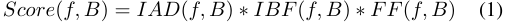
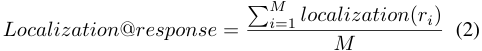
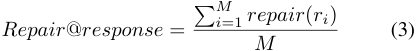
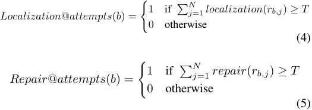
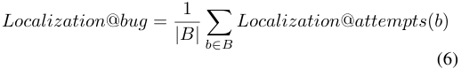
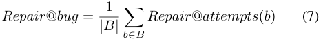
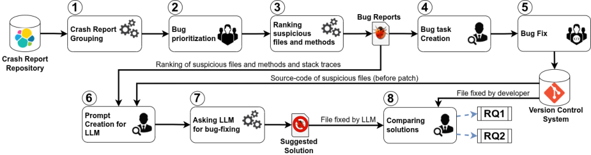

<!-- Chuyển tự động từ 2609.04483v1.pdf (pymupdf4llm); ảnh trong 2609.04483v1_images/ -->

# Integrating Crash Report Mining and LLMs for Bug Localization and Repair: An Industrial Report 

Marcos Medeiros_∗_ , Uir´a Kulesza_∗_ , Christoph Treude_†_ , Daniel Lucena_∗_ , Rafael Gomes_∗_ , Roberta Coelho_∗_ , Eiji Adachi_∗_ , Rodrigo Bonifacio_‡_ 

_∗Federal University of Rio Grande do Norte_ (Natal, Brazil) 

Email: _{_ marcosamm, rlucena.daniel, rafaggsique _}_ @gmail.com, _{_ uira, roberta _}_ @dimap.ufrn.br, eijiadachi@imd.ufrn.br 

_†Singapore Management University_ (Singapore, Singapore) Email: ctreude@smu.edu.sg 

_‡Federal University of Pernambuco_ (Recife, Brazil) Email: rbonifacio@cin.ufpe.br 

**_Abstract_ —Analyzing crash-report bugs in large-scale industrial software systems requires substantial maintenance effort, particularly in production environments where developers must handle large volumes of crash reports and source code artifacts to localize and fix their root causes. While recent studies have shown that Large Language Models (LLMs) can assist with maintenance tasks, little is known about their effectiveness in supporting developers in analyzing crash-report bugs and repairing bugs associated with groups of crash reports in industrial settings. To address this gap, we investigate whether integrating crash report mining techniques—specifically stack trace clustering and suspicious file and method ranking—with LLMs can support crash localization and repair in production environments. We conduct a retrospective evaluation of five LLMs under four prompt configurations. After that, we chose the best model to run on 38 crash bugs collected from two large Java enterprise systems. We further analyze the structural characteristics and explanatory patterns of LLM-generated responses and assess localization and repair effectiveness through manual validation. Our results show that the best-performing configuration localizes up to 71% and correctly repairs 52% of crash bugs on the full dataset. These findings provide empirical evidence that combining crash report mining with LLM-based repair can effectively support debugging activities in industrial maintenance workflows.** 

**_Index Terms_ —Software crash, Bug correlation, Bug localization, LLM, Bug fixing** 

## I. INTRODUCTION 

Crash reports and stack traces are widely used by developers to analyze system failures and support bug localization and resolution tasks [1]–[5]. However, as crash reports accumulate over time, large-scale analysis becomes increasingly challenging [1], [6]. For example, Firefox receives millions of crash reports every month [7], [8]. In practice, developers must manually inspect stack traces and navigate large codebases to identify the root cause of a crash, which becomes increasingly costly as the volume of crash reports grows. To reduce this effort, prior research has investigated crash report aggregation techniques and shown that they can support bug localization and repair activities [5], [9]–[22]. 

In parallel, the evolution and popularization of Large Language Models (LLMs) have enabled developers to leverage these systems for co-development and software quality assessment, particularly in program repair tasks [23], [24]. Recent studies have explored the application of artificial intelligence to several software engineering tasks and report promising 

results [25]–[33]. Despite these advances, prior work [25]– [27] indicates that LLMs require sufficient contextual information and guidance to effectively locate and fix crash bugs. However, providing unrestricted access to entire codebases is often impractical in industrial environments due to cost, confidentiality, and LLM context window limitations. Thus, a key challenge is how to provide LLMs with structured and prioritized contextual information that narrows the search space while preserving relevance to the failure. 

Crash report mining techniques, such as stack trace clustering and suspicious file and method ranking, provide structured contextual information by identifying artifacts most likely associated with a crash. However, empirical studies conducted in industrial settings remain scarce [34], [35]. To the best of our knowledge, no previous work has systematically integrated crash mining with suspicious file and method ranking to provide structured contextual input to LLMs in a workflow validated on industrial production systems. 

In this work, we present and empirically evaluate a pipeline that integrates crash report mining with LLMs to support crash bug localization and repair under realistic industrial constraints. The proposed workflow consists of three stages: crash report clustering, suspicious file and method ranking, and LLM-based patch suggestion. Our study focuses on largescale web-based systems implemented using Java Enterprise technologies and adopts a retrospective evaluation to assess how effectively LLMs can locate and fix bugs from crash report data. Our findings reveal that LLMs frequently suggest plausible fixes, even though structural heterogeneity makes automated patch integration infeasible. Surprisingly, the most explanation-prone model achieved the best localization and repair accuracy, while the most prompt-compliant model underperformed. The main contributions are: 

- A novel approach that integrates crash report clustering and suspicious file and method ranking to provide structured contextual input for LLMs performing crash bug localization and repair. 

- An ablation-based evaluation on the impact of contextual information (stack traces, stack messages, and ranking information) on LLM-based crash localization and repair. 

- A validation of our approach that compares its ability to locate and fix crash root causes against developer 

corrective commits used as ground truth, showing that combining crash report mining with LLM-based repair effectively supports debugging in an industrial context. 

The remainder of this paper is organized as follows. Section II presents the proposed bug localization and fixing approach. Section III describes the target systems, LLM models, prompt combinations, evaluation metrics, and study procedures. Section IV presents and discusses the results, followed by threats to validity in Section V, related work in Section VI, and conclusions in Section VII. 

## II. BUG LOCALIZATION AND FIXING APPROACH 

Our approach integrates existing crash report mining techniques with LLM-based repair suggestions into a unified debugging pipeline. Specifically, we adopt previously proposed methods for crash report grouping and suspicious artifact ranking, and use their outputs to construct structured contextual prompts for LLM-based bug localization and repair. The proposed approach consists of three main steps: (i) grouping crash reports that generate similar stack traces; (ii) ranking files suspected of causing the crashes; and (iii) using LLMs to localize bugs and suggest fixes for the code. The procedures for Steps (i)–(ii) were adopted from previous literature [36], [37]. Next, we describe each step. 

## _A. Crash Report Grouping_ 

Following related work [13], [14], [22], [36], [37], we group crash reports according to stack trace similarity to consolidate related failures. This grouping aims to reduce the effort required to identify the root causes of these failures. In the following discussion of grouping levels, we use the acronyms STA and STB to denote two stack traces in the crash report database. 

**(Level 1) Identical Stack Trace** . Initially, we group crash reports when two stack traces are identical (STA = STB). The signature representing each group is the stack trace itself. 

**(Level 2) Equivalent Signature** . After grouping identical stack traces, we further merge traces that differ only in minor implementation-specific details. For example, consider the following two stack traces, STA and STB: 

_• at ...GeneratedMethodAccessor10184.invoke() ∈_ STA 

_• at ...GeneratedMethodAccessor10272.invoke() ∈_ STB These traces differ only in the generated numeric suffix – _10184_ and _10272_ . Such variations do not affect the crash semantics; therefore, we treat the corresponding stack traces as equivalent and group their crash reports. 

After handling exact and near-exact matches, we progressively broaden the similarity criteria to capture structurally related failures. The remaining levels follow the cumulative grouping strategy proposed by Wang et al. [14]. 

**(Level 3) Crash Type Signature** . We further merge Level 2 groups when one stack trace is structurally contained within another (STA _⊆_ STB or STB _⊆_ STA). To check containment, we compare only fully qualified method calls (package, class, and method names), ignoring line numbers, since they may vary due to formatting without affecting the crash semantics. 

**(Level 4) Top Frame File** . Finally, we merge Level 3 groups whose crash points originate from the same qualified top-frame file. For example, consider stack traces STA and STB, where: 

- _at s.p.ClassMBean.methodA(ClassMBean.java:280)_ is the signaler in STA 

- _at s.p.ClassMBean.methodB(ClassMBean.java:251)_ is the signaler in STB 

In both cases, the method names differ, but the qualified file name is the same ( _s.p.ClassMBean_ ), and this rule groups such stack traces. In other words, if different stack traces signal exceptions in the same class, we consider them manifestations of the same underlying fault and group their crash reports, as validated in our previous work [36], [37]. 

## _B. Suspicious file and method ranking_ 

After grouping crash reports (Section II-A), we analyze the files appearing in each group’s stack traces to identify those most likely responsible for the crash. To this end, we adapt the ranking approach proposed by Wu et al. [21] to the file level rather than the method level. Each file is scored using three criteria: (i) Inverse Average Distance to Crash Point (IAD) that favors class files that appear closer to the crash point in the stack trace; (ii) Inverse Bucket Frequency (IBF) that penalizes files frequently associated with different faults; and (iii) File Frequency (FF) that rewards files that frequently appear within the same crash group. 

The final score of a file _f_ appearing in the stack traces of a crash group _B_ is computed as follows: 

<!-- Start of picture text -->
Score ( f, B ) =  IAD ( f, B )  ∗ IBF ( f, B )  ∗ FF ( f, B ) (1) <!-- End of picture text -->

The multiplicative formulation ensures that highly ranked files simultaneously satisfy three complementary properties: proximity to the crash point (IAD), specificity to the crash group (low IBF), and recurrence within the same failure context (FF). This combination prioritizes artifacts that are both structurally close to the failure signal and statistically consistent within the crash cluster, while penalizing overly generic files frequently associated with unrelated faults. Files are therefore ranked in descending order of this score to derive structured and prioritized contextual information, highlighting the most plausible root-cause candidates while reducing noise from unrelated crash groups. 

**_Suggesting suspicious methods_** . After ranking files, we identify the methods within the top-ranked files that appear in the stack traces of the crash group and suggest them according to their frequency. 

## _C. Bug fixing_ 

After ranking suspicious files and methods for a crash report group, we extract the source code of the top-ranked files together with a representative stack trace to construct a structured contextual prompt. This prompt is submitted to the LLM to generate a patch suggestion, which is then attached to the corresponding crash report to assist developers during bug triage and bug resolution. 

Our prompt design builds upon the findings of Du et al. [26], [27], who showed that enriched crash information (e.g., exception type and error message) and role-based instructions improve LLM performance in bug localization and repair. Following their insights, we adopt a zero-shot strategy and structure the prompt into five components (Listing 1): role specification, suspicious source code files, crash information (stack traces or stack messages), ranking information, and a repair request. We use zero-shot prompting due to input size constraints and context window limitations of current LLMs. Additionally, zero-shot prompting avoids potential overfitting to handcrafted exemplars and better reflects realistic industrial deployment scenarios, where representative labeled examples may not be readily available for each new crash category. 

Listing 1. Zero-shot prompt structure 

- 1 **Role-Play-Part** : I want you to act as a fault localization and program repair expert. You will be able to provide the solutions’ source code to fix the given program crash. Do not provide any explanations, just source code. 

- 2 **Suspicious-Code-Part** : This is my code: 3 ‘‘‘ 4 _[Suspicious file’s source code 1..n]_ 5 ‘‘‘ 6 **Stack-Trace-Information-Part** : I am getting: 7 ‘‘‘ 8 _[Stack trace 1..n]_ 9 ‘‘‘ 

- 10 **Stack-Message-Information-Part** : I am getting: 11 ‘‘‘ 12 _[Stack message 1..n]_ 13 ‘‘‘ 14 **Ranking-Information-Part** : This is the ranking of classes and methods most suspected of 

- containing the bug: 

- 15 _1) Class1.java:_ 16 _- methodA_ 17 _3) Class2.java:_ 18 _- methodB_ 19 _- methodC_ 20 _n) ClassN.java:_ 21 _- methodN_ 22 **Asking-Part** : Give me the patched code to fix the program crash. 

## III. EMPIRICAL STUDY 

This study evaluates the integration of crash report clustering, suspicious file and method ranking, and LLM-based patch suggestion in an industrial setting. We investigate whether structured contextual information derived from crash mining can effectively support LLM-based bug localization and repair. To guide this investigation, we address the following research questions: 

_RQ1 – What are the structural and explanatory characteristics of the responses generated by LLMs when suggesting fixes for software crashes?_ This question analyzes the form and content of LLM outputs, including code completeness, granularity, and explanatory behavior. 

_RQ2 – What information provided for the clustering and ranking approach helps LLMs locate and fix the crash?_ This research question investigates whether and which information produced by the clustering approach contributes to improving 

TABLE I 

TARGET SYSTEMS CHARACTERIZATION 

|System|Classes|Lines of code|Daily Requests|
|---|---|---|---|
|SIGAA|8,156|1,323,196|1,208,326|
|SIGRH|4,405|778,588|92,877|
|Total|12,561|2,101,784|1,301,203|

the bug fixes generated by LLMs. We investigate this question through an ablation-style evaluation that systematically varies exception granularity and ranking information to quantify their marginal contributions to localization and repair effectiveness. This ablation study involves two stages: (i) initially on a subset of crash bugs using different LLMs and prompt configurations; and (ii) then evaluating whether the localization and repair performance observed in the initial experimental subset remains consistent when applied to the complete dataset. 

Following the evaluation guidelines for empirical studies in Software Engineering involving LLMs [38], Section III-A describes the target systems and industrial context. Section III-B details the selected LLMs and configurations. Section III-C presents the prompt combinations. Section III-D describes the evaluation procedure and human validation. 

## _A. Target Systems_ 

The study was conducted in collaboration with the software development department of a public institution responsible for maintaining several large-scale web-based systems. We focused on two Java Enterprise systems that together receive over one million daily requests and comprise approximately 2.1 million lines of code across more than 12,000 classes (Table I). Both systems have been in operation for over 16 years and are actively used and customized by more than 30 institutions. Approximately 70% of the codebase consists of Java files, 29% corresponds to web pages (HTML, JSP, JSF), and the remaining 1% consists of other assets (build files, CI/CD configuration files, and so on). 

The first system (SIGAA) in Table I is an Integrated Academic Management System and generates approximately 9,200 crash reports per week. SIGRH is an Integrated Human Resource Management System, generating approximately 290 weekly crash reports. 

The organization involved in this study does not maintain enterprise-level agreements with LLM providers that grant unrestricted source code access, mainly due to intellectual property and cost constraints. This may also be the case for many companies of similar size and characteristics. Therefore, the use of LLMs was limited to REST API calls with restricted input, providing only the source code of a few suspicious files to balance cost and confidentiality. This constraint underscores the need to provide LLMs with structured and prioritized contextual information. 

## _B. Target LLMs_ 

We selected LLMs based on the following criteria: (i) widespread adoption; (ii) availability via REST API; (iii) 

cloud-based execution support; and (iv) context window size. Thus, we evaluated the following models: 

- claude-3-5-sonnet-20240620 (Anthropic), 

- gemini-1.5-pro (Google), 

- gpt-4o-mini (OpenAI), 

- mistral-large-2407 (Mistral), and 

- llama3-405b-instruct-maas (Meta). 

To avoid bias introduced by restrictive parameter tuning, we fixed the temperature at 1.0 and retained the default provider configurations unless mandatory parameters were required (e.g., max-tokens=8192 for Anthropic). 

## _C. Prompt combinations_ 

All prompt configurations are built upon the source code of the top-ranked suspicious files (SCoSF), enriched with crashrelated contextual information. In particular, we systematically vary two components of the context provided to the LLMs: (i) the level of exception detail—either the full stack trace (ST) or only the stack message (SM); and (ii) the inclusion of structured ranking information, namely the Rank of Suspicious Files and Methods (RoSFM) produced by our clustering and ranking approach. 

The first dimension controls the granularity of exception information supplied to the model, ranging from the complete execution context (ST) to a reduced representation containing only the exception type and error message (SM). Stack messages (SM) therefore consist only of exception types and their corresponding messages in a stack trace, including nested causes introduced by the _“Caused by:”_ lines, and exclude the full method call stack. This reduction significantly decreases prompt size and cost, allowing us to assess whether full stack traces are necessary for effective repair. The second dimension evaluates whether explicitly providing ranked suspicious artifacts (RoSFM) improves localization and repair performance compared to relying solely on raw crash information. 

Based on these factors, we evaluated the following prompt configurations: 

- **SCoSF+ST** : source code of suspicious files and the full stack trace. 

- **SCoSF+ST+RoSFM** : source code, stack trace, and ranking of suspicious files and methods. 

- **SCoSF+SM** : source code and stack message (exception type and error message only). 

- **SCoSF+SM+RoSFM** : stack message combined with ranking information. 

In all configurations, we provide the source code of the top three suspicious files identified by our ranking approach. As mentioned earlier, providing the full codebase would be impractical in our setting due to confidentiality constraints, costs, rate limits, and the context window limitations of LLMs. Crash information is included to guide the LLM toward resolving the specific failure without addressing unrelated issues. 

The resulting configurations enable an ablation analysis of contextual enrichment components, allowing us to quantify the marginal contribution of ranking information and exception granularity to LLM-based crash bug localization and repair. 

## _D. Evaluation metrics_ 

We adopted a manual evaluation protocol, using the developer’s corrective commit as ground truth to assess whether the LLM-generated responses correctly localized the modified artifact and produced a semantically valid repair. For example, a repair was considered correct (plausible) if the LLM modified the same method as the developer and introduced a change that would prevent the observed exception, even if the implementation differed from the developer’s patch. This decision stems from limited test infrastructure, restricted access to full source artifacts, high rebuilding costs, and the need to manually assess semantic equivalence, as LLMgenerated patches may differ syntactically from developer fixes while still resolving—or failing to resolve—the underlying fault. Given these constraints, automated metrics such as _pass@k_ [39] or BLEU [40] were unsuitable, since correctness depended on semantic validation rather than syntactic similarity or test-based execution. 

Accordingly, we evaluated performance at two levels of granularity: (1) per-response, capturing correctness across all individual attempts; and (2) per-bug, capturing consistency across multiple attempts for the same crash bug. The _Per-response_ assessment involves two metrics: _Localization@response_ and _Repair@response_ , where 

- (a) _Localization@response_ measures the proportion of responses that correctly identify the artifact modified in the developer’s commit: 

<!-- Start of picture text -->
� Mi =1 localization ( ri ) Localization @ response  = (2) M <!-- End of picture text -->

- (b) _Repair@response_ measures the proportion of responses that produce a valid patch equivalent to, or a valid alternative to, the developer’s fix: 

<!-- Start of picture text -->
� Mi =1 repair ( ri ) Repair @ response  = (3) M <!-- End of picture text -->

In both @ _response_ metrics, _M_ denotes the total number of responses, and the indicator functions return 1 for correct localization or repair and 0 otherwise. 

To assess robustness under repeated attempts, we evaluate correctness at the bug level by considering consistency across multiple responses. A bug is considered successfully localized (or repaired) if the majority of its responses are correct. 

Formally, for a bug _b_ with _N_ attempts, we define a binary success indicator based on a majority threshold _T_ . Accordingly, we leverage two indicators in the _Per-bug_ assessment: _Localization@attempts_ and _Repair@attempts_ , where: 

<!-- Start of picture text -->
1 if � N j =1 localization ( rb,j )  ≥ T Localization @ attempts ( b ) = 0 otherwise � (4) 1 if � N j =1 repair ( rb,j )  ≥ T Repair @ attempts ( b ) = 0 otherwise � (5) <!-- End of picture text -->

The final per-bug metrics are obtained by averaging these indicators across all bugs _B_ : 

<!-- Start of picture text -->
1 Localization @ bug = � Localization @ attempts ( b ) |B| b∈B (6) <!-- End of picture text -->

<!-- Start of picture text -->
1 Repair @ bug = � Repair @ attempts ( b ) (7) |B| b∈B <!-- End of picture text -->

_E. Study Procedures_ 

We conducted (i) a longitudinal industrial deployment of the crash mining and bug management pipeline, and (ii) a retrospective evaluation of LLM-based localization and repair using artifacts generated during real maintenance activities. Fig. 1 provides an overview of the study workflow. 

_a) Industrial Phase:_ Over an 18-month period, we executed the crash mining and bug management process on a weekly basis in the production environment. This phase comprises steps (1)–(5) in Fig. 1. 

In the first step **(Step 1 — Crash report grouping)** , we collected crash reports generated during the previous seven days from the production systems and clustered them using the approach described in Section II-A. For each crash group, we shared the following information with the development teams: the group identifier, the first and last occurrence dates, the number of crash reports, the number of affected Uniform Resource Identifiers (URIs), the total number of impacted users, and the list of system classes appearing in the stack traces. Next, in the second step **(Step 2 — Bug prioritization)** , the development teams analyzed this information to assess the impact and scope of each crash group and selected those to be addressed in the current development cycle. 

After that, in the third step **(Step 3 — Ranking suspicious files and methods)** , for each selected crash group, we extracted the files and methods appearing in the stack traces and ranked these assets according to the approach described in Section II-B. In the fourth step **(Step 4 — Bug task creation)** , we created issue-tracker tasks containing the top five suspicious files and methods together with additional contextual information extracted from the crash-report database. In the final step **(Step 5 — Bug fixing)** , developers were assigned these tasks, identified the root cause, implemented the corresponding patch, and closed the issue. 

After executing these five steps continuously for 18 months, we constructed a dataset containing the buggy code, the ranking of suspicious files and methods, the most frequent stack traces, and the patched code for each crash group. More details are provided in Section IV-A. 

_b) Retrospective LLM Evaluation:_ This phase comprises steps (6)–(8) in Fig. 1. In the sixth step **(Step 6 — Prompt creation)** , for each item in our dataset we instantiated the prompt template detailed in Section II-C, including at most the top three source codes of suspicious files (SCoSF) and the most frequent stack trace (ST) of the group. This restriction reflects 

practical LLM context-window and rate-limit constraints typically observed in industrial settings. To conduct an ablationstyle analysis, we generated four prompt configurations, as detailed in Section III-C. For each crash, we generated all prompt combinations and used them in every attempt across all LLMs. Consequently, there was no difference in the content sent to the LLMs. This retrospective setup enables controlled comparison with developer fixes while approximating realistic debugging scenarios encountered in industrial maintenance. 

Next, in the seventh step **(Step 7 — Asking LLM for bug fixing)** , we submitted each prompt to the corresponding LLM via REST API using the configuration described in Section III-B. To mitigate cross-request contamination, we executed each invocation in a fresh session with no shared conversational history. Given the stochastic nature of LLM outputs, we performed five individual zero-shot requests per prompt configuration. For an initial subset of the dataset, we evaluated five distinct LLMs (Section III-B) for each prompt combination to answer RQ1 and RQ2. After that, we applied the best-performing LLM, using all prompt combinations, to the full dataset to assess robustness and answer the second stage of RQ2. 

Finally, in the eighth step **(Step 8 — Comparing solutions)** , we compared each LLM response with the corresponding developer solution and analyzed the correctness of localization and repair. Two reviewers independently assessed whether the response correctly localized the modified artifact and whether it produced a semantically valid repair. Disagreements were resolved through discussion, and a third reviewer made an additional judgment in cases where the first two reviewers did not reach consensus. 

Localization was considered correct when the LLM suggested a fix to the same snippet of code that the developer changed in the bug fix commit. For NullPointerException, we judged localization as correct only if the LLM fix attempted to resolve the problem in the same variable identified by the developer. Modifying the correct file, but a different code location counts as incorrect. The prompts averaged 2,244 lines of code (range: 100–7,717). 

Repair was considered correct (plausible) when the generated patch was equivalent to, or a valid alternative implementation of, the developer’s fix. Unsuccessful repair responses were categorized as: (i) “Incomplete fix”, (ii) “Provided a fix but introduced a new bug”, (iii) “Tried to fix something else”, (iv) “Incomplete response”, (v) “Suggested a fix but not the patched code”, or (vi) “Requested more details”. This classification scheme was inspired by Sobania et al. [28]. 

## IV. RESULTS AND DISCUSSION 

This section presents the results of our dataset construction process and our analysis of the structural and explanatory characteristics of the LLM responses. It also reports the information provided by the clustering and ranking approach, which assists the LLM in locating and fixing the bugs that led to crash reports. Finally, it examines whether the effectiveness of 

<!-- Start of picture text -->
® x 2 aRanking Bug task . CrashGrouping Reportiy prioritizationBug filesseeeus and methodsee eet Bug Fix Crash Report Ranking of suspicious files and methods and stack traces Repository Source-code of suspicious files (before patch) 9) ® Fie medy donor | @)> Promptcisation e ‘Asking LLM. oy G) fie tresev iim, | comparing @ -»|{[Rat]][Rat] Version‘System Control tM fo lie for bug-fixing ‘Suggested solutions UD ->(]Ra2]] Solution <!-- End of picture text -->

Fig. 1. Study overview 

the best-performing LLM remains consistent when evaluated across the full dataset. 

## _A. Dataset Building_ 

We built our dataset based on crash bugs grouped, ranked, and prioritized by our localization approach and subsequently fixed by development teams (Steps 1–5 in Fig. 1). Over 18 months, 131 correction issues were opened on crash groups. Teams autonomously analyzed 86 (prioritized by demand and criticality): 24 closed without crash reproduction, 62 produced code changes, and 50 had Java commits. We selected crash groups that were resolved through code changes and for which a corrective commit could be clearly identified in the version history. From an initial set of 14 SIGAA and 31 SIGRH issues, we sampled 20% per system to form SMALLDS. One SIGRH issue was excluded during its analysis. Later, while analyzing the remaining issues, 4 SIGAA and 2 SIGRH issues were excluded for the same reason (exceeded LLM context limits). We mined GitLab for the buggy (before the commit) and patched (after the commit) versions of the top three suspicious files for the resulting 38 resolved issues (10 from SIGAA and 28 from SIGRH), allowing a fair comparison between LLM-suggested fixes and developer patches. For each issue, we also included the top three ranked suspicious files and the top two frequent stack traces to complete the dataset, with the developer-modified file ranked within the top three for all 38 issues (36 first, 1 second, 1 third). We limited the number of files and stack traces due to LLM API limits. All issues were code-related, with no environmental factors involved. 

## _B. Analysis of LLM Responses and Effectiveness_ 

To evaluate RQ1 and the first stage of RQ2, we conducted a full cross-model comparison on the eight-issue SMALLDS (3 from SIGAA and 5 from SIGRH) described in Section IV-A. Each crash bug required the manual assessment of 100 LLM outputs (4 prompt combinations × 5 models × 5 attempts), resulting in 800 responses for the SMALLDS alone. Expanding this analysis to all 38 crash bugs would require evaluating 3,800 responses, which would be infeasible in the context of this study. We therefore adopted SMALLDS for model comparison and subsequently validated the best-performing configuration on the full dataset (FULLDS) to assess robustness. 

Each LLM-generated patch was independently assessed by at least two authors. Disagreements were resolved by consensus, with no need for a third reviewer. Inter-rater agreement, measured via Cohen’s Kappa [41], was substantial for bug localization ( _κ_ =0.767, 95% CI [0.723, 0.812]) and moderate for both repair status ( _κ_ =0.500, 95% CI [0.425, 0.576]) and fix category ( _κ_ =0.583, 95% CI [0.544, 0.622]). 

**RQ1 – What are the structural and explanatory characteristics of the responses generated by LLMs when suggesting fixes for software crashes?** After analyzing the responses generated by LLMs, we observed that they varied considerably in structure. Responses included one or more entire classes, partial fragments, or a mixture of both, as illustrated in Listing 2. To preserve confidentiality, the listings were anonymized by modifying method and variable names. 

Even when the prompt explicitly instructed the model to return only source code without any explanation, LLMs frequently violated this constraint—providing rationales either as inline comments within the code or as free text outside the code blocks, as shown in Listing 2. Furthermore, LLMs provided instructions for completing the code in various ways ( _..._ , _//..._ , _// ...(existing code)_ , _//...(rest of the method)_ , among others). We also observed the omission of documentation in the suggested code. These omissions, combined with non-compliance with prompt instructions, the diversity of responses, and the inherent non-determinism of LLMs, represent a relevant challenge for automated patch extraction pipelines in settings similar to ours. 

   - Listing 2. Fragments Single Class 

- 1 The bug is in the ‘isDateVisible‘ method of the ‘AbsenceMBean‘ class. This method is called in the ‘form.jsp‘ file, and it throws a ‘ NullPointerException‘ because the ‘attachment‘ object is null. 

- 2 To fix this bug, we need to ensure that the ‘ attachment‘ object is not null before calling the ‘isDateVisible‘ method. We can do this by adding a null check in the ‘isDateVisible‘ method: 

- 3 ‘‘‘java 4 public boolean isDateVisible(){ 5 if (attachment == null) { 6 return false; 7 } 

- 8 return !isEmpty(attachment.getDocType()) && attachment.getDocType().isDateRequired(); 

- 9 } 

- 10 ‘‘‘ 11 Alternatively, we can also initialize the ‘ attachment‘ object in the ‘startUpdate‘ method before calling the ‘isDateVisible‘ method: 

- 12 ‘‘‘java 13 public String startUpdate() throws ArqException { 

- 14 // ... 15 attachment = new absenceDocument(); 16 attachment.setDocType(new DocType()); 17 // ... (rest of the method) 18 } 19 ‘‘‘ 

Therefore, we manually classified the responses to characterize them and analyze the feasibility of using automated methods to measure effectiveness. We classified the responses into the following types: _Full Single Class_ , _Full Multiple Classes_ , _Full Class + Partial Class_ , _Fragment Multiple Classes_ , _Fragment Single Class_ , _Fragments Single Class_ , _NonJava Code_ , and _Explanation Only_ . 

Table II shows that a single fragment of one class was the most frequent response type ( _Fragment Single Class_ ), considering every LLM and prompt. In the tables, ”all” denotes the aggregate across LLMs, prompts, or both. It also reveals differences across prompt combinations (rows 2–5). _Fragment Single Class_ was most frequent in prompts containing stack traces, while prompts formed only by SCoSF and stack message (SM) generated more responses with the full source code of multiple classes ( _Full Multiple Classes_ ). Adding rank of suspicious files and methods (RoSFM) to prompts with SM led LLMs to more frequently suggest multiple fragments of a single class ( _Fragments Single Class_ ). Analyzing responses by LLM (rows 6–10), Claude generated more _Fragments Single Class_ , Gemini and Mistral responded more with _Full Multiple Classes_ , while GPT and Llama more often produced _Fragment Single Class_ . In particular, only Mistral generated _Non-Java Code_ and _Explanation Only_ responses. Gemini and Mistral also returned the full source code of a single class ( _Full Single Class_ ), although these responses were usually incomplete or truncated. 

Documentation suppression in the source occurred in 43% of responses, including Javadoc comments and inline annotations. Additionally, explanations outside code blocks appeared in 45.5% of responses, while 37.73% contained explanations embedded within the generated code. Furthermore, 15.88% of responses suppressed documentation and added explanations both within and outside the source code blocks. 

Claude exhibited the most pronounced tendency— suppressing documentation in 68.13% of its responses, adding external explanations in 90.63%, and adding internal explanations in 51.88%. In contrast, Gemini was the only model that neither suppressed documentation nor added unsolicited explanations. However, it produced the highest rate of truncated responses (48.75%). 

These results highlight the difficulty of automatically generating an adequate patch to the buggy code. Due to this difficulty and others discussed in Section III-D, we proceeded by manually analyzing the LLM suggestions to answer RQ2. 

## **Answer to RQ1** 

LLM responses vary substantially across models and prompts and often omit documentation or add unsolicited explanations, complicating automated patch extraction. 

**RQ2 – What information provided for the clustering and ranking approach helps LLMs locate and fix the crash?** To answer this research question, we first assessed how many LLM responses referenced at least one method changed by the developer to fix the bug. **_Analyzing the_ SMALLDS** . Overall, 65.75% of responses included such a method—either in a code block or in an explanation. Prompts with ST generated the most references to developer-patched methods (76%), and adding RoSFM further increased this rate to 81%, suggesting that ranking information helps LLMs focus on the relevant code location. In contrast, combinations with SM yielded lower rates (38%–68%). Analyzing results by model rather than by prompt, Claude performed best (78%), with Llama (75%) and GPT (72%) exceeding the average, while Gemini (53%) and Mistral (51%) performed below average. 

These results suggest that LLMs frequently identify the same methods that developers modified to fix the crash. Building on this observation, we further investigated whether LLMs could localize and repair bugs at a finer granularity— specifically, within individual methods. 

For the _Per-response granularity_ , we first evaluate each approach’s ability to identify bugs in individual responses. Table III (Columns 2–5) reports localization accuracy per response (Section III-D). Claude-3.5-sonnet achieved the highest overall localization accuracy (82.5%) with SCoSF+ST+RoSFM, and nearly 70% with SCoSF+SM+RoSFM. Gemini followed the same pattern, peaking with SCoSF+ST+RoSFM, while GPT tied between SCoSF+ST and SCoSF+ST+RoSFM. Mistral achieved its best result with SCoSF+SM+RoSFM and Llama3 with SCoSF+ST. Considering repair accuracy (Columns 6–9), Claude again achieved the best overall performance, although its best prompt shifted to SCoSF+SM+RoSFM (52.5%), which is 7.5 percentage points higher than SCoSF+ST+RoSFM (45.0%). Gemini mirrored this pattern, while GPT tied between SCoSF+ST and SCoSF+SM. Mistral peaked with SCoSF+ST+RoSFM, and Llama3 with SCoSF+ST. 

For the _per-bug granularity_ assessment, we measured the number of solved problems, following Sobania et al. [28]. However, we considered a bug solved when at least three of five responses produced a correct patch. Unlike their automated test-based verification, we performed manual validation due to the lack of test suites and the difficulty of rebuilding the systems. Table IV reports localization and repair rates at the bug level (at least 3 of 5 responses correct). 

Claude localized bugs consistently in 87.5% of issues with SCoSF+ST+RoSFM, and achieved 50% repair across three prompt combinations. GPT and Mistral tied across prompts for repair (25%), while Llama3 peaked with SCoSF+ST (25%). These variations across models and metrics reinforce 

TABLE II 

STRUCTURAL RESPONSE CHARACTERISTICS (SMALLDS) 

|||Full|Full|Full class +|Fragment|Fragment|Fragments|Non-Java|Explanation|
|---|---|---|---|---|---|---|---|---|---|
|LLM|Prompt|Single Class|Multiple Classes|Partial class|Multiple Classes|Single Class|Single Class|Code|Only|
|all|all|2.63%|26.75%|0.13%|4.00%|**34.00%**|26.38%|4.00%|2.13%|
||SCoSF+ST|2.00%|24.50%|0.00%|1.50%|**44.00%**|21.50%|6.00%|0.50%|
|ll|SCoSF+ST+RoSFM|3.50%|28.00%|0.50%|2.50%|**36.50%**|22.50%|3.00%|3.50%|
|a|SCoSF+SM|1.00%|**33.00%**|0.00%|5.00%|29.50%|27.50%|2.50%|1.50%|
||SCoSF+SM+RoSFM|4.00%|21.50%|0.00%|7.00%|26.00%|**34.00%**|4.50%|3.00%|
|claude||0.00%|6.25%|0.00%|7.50%|36.88%|**49.38%**|0.00%|0.00%|
|gemini||0.63%|**80.63%**|0.00%|0.00%|0.00%|0.00%|18.75%|0.00%|
|gpt|all|0.00%|1.25%|0.00%|3.75%|**70.63%**|24.38%|0.00%|0.00%|
|mistral||11.88%|**44.38%**|0.63%|3.13%|10.00%|18.13%|1.25%|10.63%|
|llama||0.63%|1.25%|0.00%|5.63%|**52.50%**|40.00%|0.00%|0.00%|

### TABLE III 

PER-RESPONSE LOCALIZATION AND REPAIR ACCURACY (SMALLDS) 

|||Localization|@response|||Repair@|response||
|---|---|---|---|---|---|---|---|---|
|LLM|SCoSF+ST|SCoSF+ST|SCoSF+SM|SCoSF+SM|SCoSF+ST|SCoSF+ST|SCoSF+SM|SCoSF+SM|
|||+RoSFM||+RoSFM||+RoSFM||+RoSFM|
|claude|30/40 (75.0%)|**33/40 (82.5%)**|15/40 (37.5%)|27/40 (67.5%)|20/40 (50.0%)|18/40 (45.0%)|9/40 (22.5%)|**21/40 (52.5%)**|
|gemini|12/40 (30.0%)|15/40 (37.5%)|10/40 (25.0%)|10/40 (25.0%)|3/40 (7.5%)|0/40 (0.0%)|1/40 (2.5%)|4/40 (10.0%)|
|gpt|14/40 (35.0%)|14/40 (35.0%)|10/40 (25.0%)|13/40 (32.5%)|10/40 (25.0%)|9/40 (22.5%)|10/40 (25.0%)|9/40 (22.5%)|
|mistral|14/40 (35.0%)|11/40 (27.5%)|10/40 (25.0%)|15/40 (37.5%)|8/40 (20.0%)|10/40 (25.0%)|8/40 (20.0%)|9/40 (22.5%)|
|llama3|16/40 (40.0%)|14/40 (35.0%)|10/40 (25.0%)|10/40 (25.0%)|10/40 (25.0%)|6/40 (15.0%)|5/40 (12.5%)|6/40 (15.0%)|

that prompt selection is model-dependent and should be considered when fine-tuning LLM-based repair pipelines. 

Table V presents the response classification for the bestperforming LLM. Including RoSFM in the prompt appears to increase the number of fixes similar to developer patches. Overall, _SCoSF+SM+RoSFM_ (without ST) achieved the highest repair rate (52.5%), while prompts using SM instead of ST more often attempted to fix unrelated issues. 

Despite the three-way tie in Repair@bug (Table IV), SCoSF+SM+RoSFM stands out as the best overall prompt combination because it achieved the highest repair rate (52.5%) and the lowest rate of unsuccessful fixes— encompassing incomplete fixes, patches that introduced new bugs, and attempts targeting unrelated issues (Table V)— making it the most reliable configuration in the SMALLDS. 

**Insight.** _The LLM that most strictly followed the prompt instructions (Gemini) consistently underperformed, while the one that most frequently added unsolicited explanations (Claude) achieved the best results._ 

## **Answer to RQ2 (on the SMALLDS)** 

Most LLMs correctly referenced or attempted to fix at least one developer-patched method, particularly when prompts included stack traces and the ranking of suspicious files and methods. Claude-3.5-sonnet achieved the best localization performance (82.5% accuracy; 87.5% atleast-3-of-5) with SCoSF+ST+RoSFM, and the best repair results (52.5% accuracy; 50.0% at-least-3-of-5) with SCoSF+SM+RoSFM. 

**_Analyzing the_ FULLDS** **_._** After identifying the best- 

performing LLM on the SMALLDS (21% of issues), we evaluated Claude-3.5-sonnet on the FULLDS (38 crash bugs). Inter-rater agreement was almost perfect for bug localization ( _κ_ =0.882, 95% CI [0.832, 0.908]) and moderate for both repair status ( _κ_ =0.507, 95% CI [0.446, 0.568]) and fix category ( _κ_ =0.454, 95% CI [0.416, 0.493]). Disagreements were resolved by consensus; a third reviewer was consulted as a tiebreaker for one response. In general, the proportion of responses that referenced at least one developer-patched method decreased slightly from 78% to 76%, with _SCoSF+SM_ being the only combination that improved (45% to 49%). 

With respect to _Per-response granularity_ , Table VI reports per-response accuracy on the FULLDS. For localization, _SCoSF+ST_ achieved the best result (71.05%), while _SCoSF+ST+RoSFM_ —the top combination in the SMALLDS—dropped from 82.5% to 69.47%. For repair, _SCoSF+ST_ also achieved superior performance (51.58%), with the largest gain observed for _SCoSF+SM_ (22.5% to 28.42%), while the previously best-performing combination _SCoSF+SM+RoSFM_ declined from 52.5% to 47.37%. 

Considering the assessment at the bug level (i.e., _Per-bug granularity_ assessment), Table VI shows that the combinations with ST generally declined for localization, while those with SM improved. For localization, _SCoSF+ST_ remained the top performer (71.05%), despite dropping from 75%, while _SCoSF+ST+RoSFM_ decreased from 87.5% to 68.42%. For repair, _SCoSF+ST_ was the only combination to improve (50% to 52.63%), while _SCoSF+SM+RoSFM_ dropped from 50% to 47.37% and _SCoSF+SM_ gained modestly (25% to 28.95%). 

Analysis of fix categories (Table VII) corroborates these findings: _SCoSF+ST_ achieved the highest correct fix rate (51.58%) and the lowest incomplete fixes, bug introduc- 

TABLE IV 

PER-BUG LOCALIZATION AND REPAIR ACCURACY (SMALLDS) 

|||Localizati|on@bug|||Repair|@bug||
|---|---|---|---|---|---|---|---|---|
|LLM|SCoSF+ST|SCoSF+ST +RoSFM|SCoSF+SM|SCoSF+SM +RoSFM|SCoSF+ST|SCoSF+ST +RoSFM|SCoSF+SM|SCoSF+SM +RoSFM|
|claude|6/8 (75.0%)|**7/8 (87.5%)**|3/8 (37.5%)|5/8 (62.5%)|**4/8 (50.0%)**|**4/8 (50.0%)**|2/8 (25.0%)|**4/8 (50.0%)**|
|gemini|2/8 (25.0%)|3/8 (37.5%)|2/8 (25.0%)|2/8 (25.0%)|0/8 (0.0%)|0/8 (0.0%)|0/8 (0.0%)|1/8 (12.5%)|
|gpt|3/8 (37.5%)|3/8 (37.5%)|2/8 (25.0%)|2/8 (25.0%)|2/8 (25.0%)|2/8 (25.0%)|2/8 (25.0%)|2/8 (25.0%)|
|mistral|3/8 (37.5%)|2/8 (25.0%)|2/8 (25.0%)|3/8 (37.5%)|2/8 (25.0%)|2/8 (25.0%)|2/8 (25.0%)|2/8 (25.0%)|
|llama3|3/8 (37.5%)|3/8 (37.5%)|2/8 (25.0%)|2/8 (25.0%)|2/8 (25.0%)|1/8 (12.5%)|1/8 (12.5%)|1/8 (12.5%)|

TABLE V 

CATEGORIES OF LLM-GENERATED FIXES FOR CLAUDE-3.5-SONNET-20240620 (SMALLDS) 

|Category|SCoSF+ST|SCoSF+ST+RoSFM|SCoSF+SM|SCoSF+SM+RoSFM|
|---|---|---|---|---|
|Fix similar to the developer’s|25.0%|32.5%|15.0%|37.5%|
|Fix using an alternative implementation|25.0%|12.5%|7.5%|15.0%|
|Incomplete fix|7.5%|7.5%|0.0%|0.0%|
|Provides a fix but introduced a new bug|17.5%|30.0%|15.0%|15.0%|
|Tries to fix something else|25.0%|17.5%|62.5%|32.5%|
|Incomplete response|0.0%|0.0%|0.0%|0.0%|
|Suggested a fix but not the patched code|0.0%|0.0%|0.0%|0.0%|

### TABLE VI 

LOCALIZATION AND REPAIR ACCURACY (FULLDS) — CLAUDE-3.5-SONNET-20240620 

||Per-respo|nse|Per-|bug|
|---|---|---|---|---|
|Prompt|Localization@response|Repair@response|Localization@bug|Repair@bug|
|all|473/760 (62.24%)|332/760 (43.68%)|29/38 (76.32%)|22/38 (57.89%)|
|SCoSF+ST|**135/190 (71.05%)**|**98/190 (51.58%)**|**27/38 (71.05%) **|**20/38 (52.63%)**|
|SCoSF+ST+RoSFM|132/190 (69.47%)|90/190 (47.37%)|26/38 (68.42%)|17/38 (44.74%)|
|SCoSF+SM|84/190 (44.21%)|54/190 (28.42%)|17/38 (44.74%)|11/38 (28.95%)|
|SCoSF+SM+RoSFM|122/190 (64.21%)|90/190 (47.37%)|24/38 (63.16%)|18/38 (47.37%)|

tions, and unrelated fix (48.42%) among all combinations. Notably, this contrasts with the SMALLDS results, where _SCoSF+SM+RoSFM_ was the top combination. 

Although adding _RoSFM_ slightly reduced performance when _ST_ was provided, it substantially improved _SCoSF+SM_ performance: per-response localization (44.21% to 64.21%) and repair (28.42% to 47.37%), and per-bug localization (44.74% to 63.16%) and repair (28.95% to 47.37%). 

## **Answer to RQ2 (on the FULLDS)** 

Using Claude-3.5-sonnet on the full dataset, the approach generalized well, with _SCoSF+ST_ emerging as the best combination for both localization (71.05%) and repair (52.63%), with RoSFM’s benefit being context-dependent (helping with SM, not with ST). 

## V. THREATS TO VALIDITY 

Following established guidelines for empirical software engineering studies [42], [43], we discuss threats to internal, construct, conclusion, and external validity. 

**_Internal Validity._** Buggy and patched code were extracted from Redmine issues and Git commits, which may contain incomplete or imprecise information. Although fixes are validated by a quality assurance team before issue closure, in the industrial context studied some commits may include partial fixes or unrelated changes. To mitigate this risk, we 

manually inspected commits and associated issue discussions when identifying the ground-truth artifact. Another threat concerns the manual evaluation of LLM-generated responses. Each response was independently analyzed by two authors, with disagreements resolved by a third reviewer. 

**_Construct Validity._** Effectiveness was measured using the metrics _Localization@response_ , _Repair@response_ , _Localization@bug_ , and _Repair@bug_ , which assess whether LLMs correctly locate the faulty artifact and produce a valid repair relative to the developer’s commit. This operationalization relies on manual inspection of LLM-generated responses rather than automated execution or test-based validation, which may introduce subjectivity when assessing semantic equivalence between generated patches and developer fixes. To reduce this threat, responses were independently evaluated by two reviewers, with arbitration by a third reviewer when necessary. Additionally, data leakage is unlikely to affect our measurements: both systems reside on a private Git server accessible only via the company’s internal network, and neither the source code nor the developer fixes are publicly available, making leakage of the bugs and fixes evaluated highly unlikely. 

**_Conclusion Validity._** Because LLMs are non-deterministic, responses may vary across executions. To mitigate this threat, we issued five independent requests per prompt configuration and considered a bug successfully localized or repaired only when a majority of responses were correct. Nevertheless, randomness in generation may still influence the results. 

TABLE VII 

CATEGORIES OF LLM-GENERATED FIXES FOR CLAUDE-3.5-SONNET-20240620 (FULLDS) 

|Category|SCoSF+ST|SCoSF+ST+RoSFM|SCoSF+SM|SCoSF+SM+RoSFM|
|---|---|---|---|---|
|Fix similar to the developer’s|43.68%|41.58%|24.21%|40.53%|
|Fix using an alternative implementation|7.89%|5.79%|4.21%|6.84%|
|Incomplete fix|4.21%|3.68%|2.63%|2.11%|
|Provides a fix but introduced a new bug|15.26%|18.42%|13.16%|14.74%|
|Tries to fix something else|28.95%|28.42%|55.26%|35.79%|
|Incomplete response|0.00%|0.00%|0.00%|0.00%|
|Suggested a fix but not the patched code|0.00%|2.11%|0.00%|0.00%|
|Requested more details|0.00%|0.00%|0.53%|0.00%|

**_External Validity._** Our study analyzes crash reports from two Java-based enterprise systems developed by the same company, which may limit generalization to other technologies or domains. Furthermore, the evaluation was conducted retrospectively using historical crash reports and developer fixes, and the results may differ in real-time debugging scenarios where developers interact with LLMs. Finally, we evaluated only general-purpose LLMs; different results may arise with specialized models or future versions of these systems. 

## VI. RELATED WORK 

Du et al. [26], [27] investigated the use of LLMs for resolving crash bugs and showed that interactive strategies, such as role-play prompts and multi-round interactions, improve effectiveness, particularly for code-related crashes. Their approach (IntDiagSolver) uses small Stack Overflow snippets, achieving high localization but modest repair results. In contrast, our study focuses on industrial crash reports, uses zero-shot prompts with richer context (full suspicious files, stack traces or messages, and ranked suspicious artifacts), and evaluates larger, real-world codebases. While our localization accuracy is slightly lower (71% vs. 76.7%), our repair accuracy is higher (52% vs. 33.3%). 

Sobania et al. [28] evaluated ChatGPT for automatic bug fixing on the QuixBugs dataset, showing competitive performance with state-of-the-art approaches and highlighting the benefits of dialog-based interaction. They considered a bug solved if at least one of four responses succeeded, correctly repairing 19 of 40 bugs (47.5%). They also classified responses into multiple categories, noting that many of them required additional information or failed to identify the bug. Our study adopts a stricter success criterion (at least 3 correct fixes out of 5 responses) and a single interaction per response. Using richer contextual prompts on real-world industrial Java crash bugs, we achieved 71% localization and 52% repair accuracy with Claude-3.5-sonnet — comparable repair performance despite the harder setting. 

Fahim et al. [44] enhanced crash reports from issue trackers of open-source systems by enriching them with stack trace fragments, method-level source code, and LLM-generated fixes, achieving up to 58% localization and 41% repair accuracy using an agentic strategy. In contrast, our work operates on raw crash reports automatically collected in production from industrial systems, without textual descriptions. We cluster crashes and rank suspicious files and methods 

based on stack traces, then provide this structured context to LLMs to suggest fixes. Evaluating multiple models and prompt combinations, we found that Claude-3.5-sonnet achieved the best performance, localizing 71% of crash bugs and correctly repairing 52% of them in an industrial setting — competitive results considering the rawer, less structured nature of our crash data. 

## VII. CONCLUSION 

We investigated whether the use of LLMs can improve and complement a bug localization approach by providing development teams with suggestions to repair crash bugs in the source code. We evaluated the effectiveness of our bug-fixing approach retrospectively by analyzing real-world bugs in an industrial context involving large-scale web-based systems implemented with Java Enterprise technologies. 

Initially, we analyzed 800 LLM-generated responses for 8 crash bugs to assess their structural and explanatory characteristics. We found that a single fragment from a single class is the most frequent response type and that both prompt combinations and the LLM model influence these characteristics. 

We also compare the localization and repair performance of four prompt combinations across five LLMs on a subset of our dataset to identify the best-performing LLM and to analyze which information provided by our clustering and ranking approach helps LLMs locate and fix crash bugs. The Claude-3.5-sonnet model achieved better performance on bug localization tasks using prompts generated from the source code of suspicious files, stack trace samples, and the ranking of suspicious files and methods. The same model performed better on bug-fixing tasks when prompts used stack messages rather than stack traces. 

Finally, we verify whether the effectiveness of the bestperforming LLM generalizes to the full dataset (38 crash bugs). We achieved better performance in bug localization (71%) and repair (52%) tasks using prompts composed exclusively of the source code of suspicious files and stack trace samples. These results indicate that structured crashmining context can enable LLMs to effectively support bug localization and repair in industrial maintenance workflows. 

## ACKNOWLEDGMENT 

Many thanks to INES.IA (www.ines.org.br), CNPq (408817/2024-0, 311749/2025-94-0), CAPES (88887.186324/2025-00), and STI/UFRN for partial support. 

REFERENCES 

predicting crashing fault residence,” _Journal of Systems and Software_ , vol. 148, pp. 88–104, 2019. 

- [1] L. An and F. Khomh, “Challenges and issues of mining crash reports,” in _2015 IEEE 1st International Workshop on Software Analytics (SWAN)_ , March 2015, pp. 5–8. 

- [2] K. Kovash, “Dramatic stability improvements in firefox,” 2010. [Online]. Available: https://blog.mozilla.org/metrics/2010/04/08/dramaticstability-improvements-in-firefox/ 

- [3] L. Thomson, “Socorro: Mozilla’s crash reporting system,” 2012. [Online]. Available: https://blog.mozilla.org/webdev/2010/05/19/socorromozilla-crash-reports/ 

- [4] N. Bettenburg, S. Just, A. Schr¨oter, C. Weiss, R. Premraj, and T. Zimmermann, “What makes a good bug report?” in _Proceedings of the 16th ACM SIGSOFT International Symposium on Foundations of software engineering_ , 2008, pp. 308–318. 

- [5] A. Schroter, A. Schr¨oter, N. Bettenburg, and R. Premraj, “Do stack traces help developers fix bugs?” in _2010 7th IEEE Working Conference on Mining Software Repositories (MSR 2010)_ . IEEE, 2010, pp. 118–121. 

- [6] K. Kinshumann, K. Glerum, S. Greenberg, G. Aul, V. Orgovan, G. Nichols, D. Grant, G. Loihle, and G. Hunt, “Debugging in the (very) large: ten years of implementation and experience,” _Communications of the ACM_ , vol. 54, no. 7, pp. 111–116, 2011. 

- [7] T. Dhaliwal, F. Khomh, and Y. Zou, “Classifying field crash reports for fixing bugs: A case study of Mozilla Firefox,” in _2011 27th IEEE International Conference on Software Maintenance (ICSM)_ , no. November 2009. IEEE, sep 2011, pp. 333–342. 

- [8] I. Ahmed, N. Mohan, and C. Jensen, “The impact of automatic crash reports on bug triaging and development in mozilla,” in _Proceedings of The International Symposium on Open Collaboration_ , 2014, pp. 1–8. 

- [9] A. Podgurski, D. Leon, P. Francis, W. Masri, M. Minch, J. Sun, and B. Wang, “Automated support for classifying software failure reports,” in _25th International Conference on Software Engineering, 2003. Proceedings._ IEEE, 2003, pp. 465–475. 

- [10] F. Khomh, B. Chan, Y. Zou, and A. E. Hassan, “An entropy evaluation approach for triaging field crashes: A case study of mozilla firefox,” in _2011 18th Working Conference on Reverse Engineering_ . IEEE, 2011, pp. 261–270. 

- [11] D. Kim, X. Wang, S. Kim, A. Zeller, S.-C. Cheung, and S. Park, “Which crashes should i fix first?: Predicting top crashes at an early stage to prioritize debugging efforts,” _IEEE Transactions on Software Engineering_ , vol. 37, no. 3, pp. 430–447, 2011. 

- [12] Y. Dang, R. Wu, H. Zhang, D. Zhang, and P. Nobel, “Rebucket: a method for clustering duplicate crash reports based on call stack similarity,” in _2012 34th International Conference on Software Engineering (ICSE)_ . IEEE, 2012, pp. 1084–1093. 

- [13] S. Wang, F. Khomh, and Y. Zou, “Improving bug localization using correlations in crash reports,” in _2013 10th Working Conference on Mining Software Repositories (MSR)_ . IEEE, may 2013, pp. 247–256. 

- [14] ——, “Improving bug management using correlations in crash reports,” _Empirical Software Engineering_ , vol. 21, no. 2, pp. 337–367, apr 2016. [Online]. Available: http://link.springer.com/10.1007/s10664-014-93339 

- [15] T. Ball, M. Naik, and S. K. Rajamani, “From symptom to cause: localizing errors in counterexample traces,” in _ACM SIGPLAN Notices_ , vol. 38, no. 1. ACM, 2003, pp. 97–105. 

- [16] J. A. Jones, M. J. Harrold, and J. Stasko, “Visualization of test information to assist fault localization,” in _Proceedings of the 24th International Conference on Software Engineering. ICSE 2002_ . IEEE, 2002, pp. 467– 477. 

- [17] J. A. Jones and M. J. Harrold, “Empirical evaluation of the tarantula automatic fault-localization technique,” in _Proceedings of the 20th IEEE/ACM international Conference on Automated software engineering_ . ACM, 2005, pp. 273–282. 

- [18] S. Nessa, M. Abedin, W. E. Wong, L. Khan, and Y. Qi, “Software fault localization using n-gram analysis,” in _International Conference on Wireless Algorithms, Systems, and Applications_ . Springer, 2008, pp. 548–559. 

- [19] C.-P. Wong, Y. Xiong, H. Zhang, D. Hao, L. Zhang, and H. Mei, “Boosting bug-report-oriented fault localization with segmentation and stacktrace analysis,” in _2014 IEEE International Conference on Software Maintenance and Evolution_ . IEEE, 2014, pp. 181–190. 

- [20] Y. Gu, J. Xuan, H. Zhang, L. Zhang, Q. Fan, X. Xie, and T. Qian, “Does the fault reside in a stack trace? assisting crash localization by 

- [21] R. Wu, H. Zhang, S.-C. Cheung, and S. Kim, “CrashLocator: locating crashing faults based on crash stacks,” in _Proceedings of the 2014 International Symposium on Software Testing and Analysis - ISSTA 2014_ . New York, New York, USA: ACM Press, 2014, pp. 204–214. [Online]. Available: http://home.cse.ust.hk/ wurongxin/files/wurongxin <u>issta2014.pdf</u> http://dl.acm.org/citation.cfm?doid=2610384.2610386 

- [22] R. Wu, M. Wen, S.-C. Cheung, and H. Zhang, “Changelocator: locate crash-inducing changes based on crash reports,” _Empirical Software Engineering_ , vol. 23, no. 5, pp. 2866–2900, 2018. 

- [23] X. Hou, Y. Zhao, Y. Liu, Z. Yang, K. Wang, L. Li, X. Luo, D. Lo, J. Grundy, and H. Wang, “Large language models for software engineering: A systematic literature review,” _ACM Transactions on Software Engineering and Methodology_ , vol. 33, no. 8, pp. 1–79, 2024. 

- [24] S. Ferino, R. Hoda, J. Grundy, and C. Treude, “Novice software developers’ perspectives on adopting llms for software engineering: a systematic literature review,” _arXiv preprint arXiv:2503.07556_ , 2025. 

- [25] Q. Zhang, T. Zhang, J. Zhai, C. Fang, B. Yu, W. Sun, and Z. Chen, “A critical review of large language model on software engineering: An example from chatgpt and automated program repair,” _arXiv preprint arXiv:2310.08879_ , 2023. 

- [26] X. Du, M. Liu, J. Li, H. Wang, X. Peng, and Y. Lou, “Resolving crash bugs via large language models: An empirical study,” _arXiv preprint arXiv:2312.10448_ , 2023. 

- [27] X. Du, M. Liu, H. Wang, J. Li, X. Peng, and Y. Lou, “Exploring large language models in resolving environment-related crash bugs: Localizing and repairing,” _ACM Trans. Softw. Eng. Methodol._ , Jan. 2026, just Accepted. [Online]. Available: https://doi.org/10.1145/3788866 

- [28] D. Sobania, M. Briesch, C. Hanna, and J. Petke, “An analysis of the automatic bug fixing performance of chatgpt,” in _2023 IEEE/ACM International Workshop on Automated Program Repair (APR)_ . IEEE, 2023, pp. 23–30. 

- [29] Z. Fan, X. Gao, M. Mirchev, A. Roychoudhury, and S. H. Tan, “Automated repair of programs from large language models,” in _2023 IEEE/ACM 45th International Conference on Software Engineering (ICSE)_ , 2023, pp. 1469–1481. 

- [30] J. A. Prenner and R. Robbes, “Automatic program repair with openai’s codex: Evaluating quixbugs,” _arXiv preprint arXiv:2111.03922_ , 2021. 

- [31] J. A. Prenner, H. Babii, and R. Robbes, “Can openai’s codex fix bugs? an evaluation on quixbugs,” in _Proceedings of the Third International Workshop on Automated Program Repair_ , ser. APR ’22. New York, NY, USA: Association for Computing Machinery, 2022, p. 69–75. [Online]. Available: https://doi.org/10.1145/3524459.3527351 

- [32] R. Paul, M. M. Hossain, M. L. Siddiq, M. Hasan, A. Iqbal, and J. Santos, “Enhancing automated program repair through fine-tuning and prompt engineering,” _arXiv preprint arXiv:2304.07840_ , 2023. 

- [33] M. Jin, S. Shahriar, M. Tufano, X. Shi, S. Lu, N. Sundaresan, and A. Svyatkovskiy, “Inferfix: End-to-end program repair with llms,” in _Proceedings of the 31st ACM Joint European Software Engineering Conference and Symposium on the Foundations of Software Engineering_ , ser. ESEC/FSE 2023. New York, NY, USA: Association for Computing Machinery, 2023, p. 1646–1656. [Online]. Available: https://doi.org/10.1145/3611643.3613892 

- [34] D. Jarman, J. Berry, R. Smith, F. Thung, and D. Lo, “Legion: Massively composing rankers for improved bug localization at adobe,” _IEEE Transactions on Software Engineering_ , vol. 48, no. 8, pp. 3010–3024, 2021. 

- [35] W. Li, Q. Li, Y. Ming, W. Dai, S. Ying, and M. Yuan, “An empirical study of the effectiveness of ir-based bug localization for large-scale industrial projects,” _Empirical Software Engineering_ , vol. 27, no. 2, p. 47, 2022. 

- [36] M. Medeiros, U. Kulesza, R. Bonif´acio, E. Adachi, and R. Coelho, “Improving bug localization by mining crash reports: An industrial study,” in _2020 IEEE International Conference on Software Maintenance and Evolution (ICSME)_ , 2020, pp. 766–775. 

- [37] M. Medeiros, U. Kulesza, R. Coelho, R. Bonif´acio, C. Treude, and E. A. Barbosa, “The impact of bug localization based on crash report mining: A developers’ perspective,” in _Proceedings of the 46th International Conference on Software Engineering: Software Engineering in Practice_ , 2024, pp. 13–24. 

- [38] S. Baltes, F. Angermeir, C. Arora, M. M. Bar´on, C. Chen, L. B¨ohme, F. Calefato, N. Ernst, D. Falessi, B. Fitzgerald _et al._ , “Evaluation 

guidelines for empirical studies in software engineering involving llms,” _arXiv preprint arXiv:2508.15503_ , 2025. 

- [39] M. Chen, J. Tworek, H. Jun, Q. Yuan, H. P. D. O. Pinto, J. Kaplan, H. Edwards, Y. Burda, N. Joseph, G. Brockman _et al._ , “Evaluating large language models trained on code,” _arXiv preprint arXiv:2107.03374_ , 2021. 

- [40] K. Papineni, S. Roukos, T. Ward, and W.-J. Zhu, “Bleu: a method for automatic evaluation of machine translation,” in _Proceedings of the 40th annual meeting of the Association for Computational Linguistics_ , 2002, pp. 311–318. 

- [41] MedCalc Software Ltd., “Inter-rater agreement (kappa),” https://www.medcalc.org/en/calc/kappa.php, version 23.5.5; accessed May 15, 2026. 

- [42] C. Wohlin, P. Runeson, M. H¨ost, M. C. Ohlsson, B. Regnell, A. Wessl´en _et al._ , _Experimentation in software engineering_ . Springer, 2012, vol. 236. 

- [43] P. Runeson and M. H¨ost, “Guidelines for conducting and reporting case study research in software engineering,” _Empirical software engineering_ , vol. 14, no. 2, pp. 131–164, 2009. 

- [44] S. Fahim, M. N. Rafi, Z. Ma, D. J. Kim _et al._ , “Crash report enhancement with large language models: An empirical study,” _arXiv preprint arXiv:2509.13535_ , 2025. 

